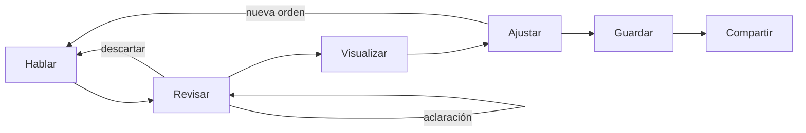
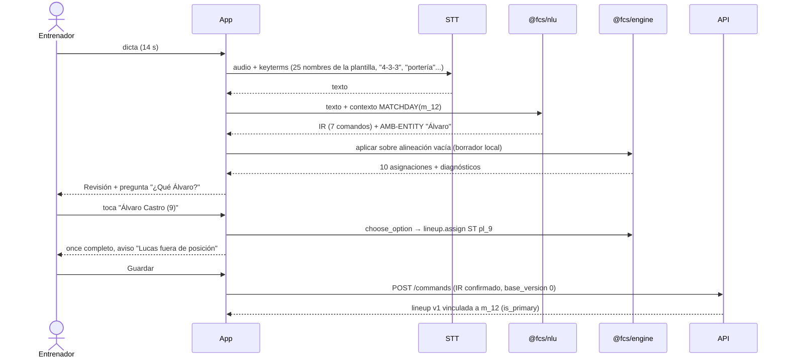

# 08 — Flujos de usuario y escenarios extremo a extremo

## 1. Flujo maestro

Flujos de alta, calendario y compartir: `diagrams/flows.md`.

## 2. Flujo semanal típico

| Día | Acción | Pantalla |
|---|---|---|
| Lunes | Observaciones posteriores del partido anterior; confirmar/refutar hipótesis | Jornada anterior |
| Martes | Dictar análisis del próximo rival | Análisis de rival |
| Miércoles–jueves | Crear/ajustar córners trabajados en el entrenamiento | Editor ABP |
| Viernes | Convocatoria y once; compartir convocatoria | Jornada, alineación |
| Sábado | Generar charla, exportar, compartir | Charla |
| Domingo | Proyectar/consultar desde el móvil | Vista previa |

---

## 3. Escenario 1 — Crear una alineación por voz

**Interacción**: en la jornada 5 (domingo 11/10/2026 vs UD Rival) el entrenador mantiene pulsado el micrófono y dice la frase de 5.0 del encargo.

**Flujo funcional**

**Datos utilizados**: plantilla (fixture de `engine/tests/command-tests.yaml`), catálogo `F_433`, partido `m_12`.

**Comandos estructurados**: los de T‑LU‑01 (`set_formation`, `link_match`, `assign`, 4×`assign_group`) + `choose_option`.

**Reglas ejecutadas**: resolución de nombres (16 §6.1) con homónimo → `AMB-ENTITY`; POSITION_FIT (18 §4); LINEUP‑01..05; vinculación "para el domingo" → partido del domingo siguiente a la fecha actual (jueves 8/10 → 11/10).

**Resultado esperado**: alineación v1 `is_primary` del partido `m_12` con GK Pablo, CB_L Mateo, CB_R Diego, LB Lucas, RB Martín, CM_L Marcos, DM Sergio, CM_R Adrián, LW Hugo, ST Álvaro C., RW Pedro; diagnóstico info LINEUP‑05 (Lucas). Ranuras dentro de grupo marcadas "inferidas".

**Tratamiento de errores**

| Error | Respuesta |
|---|---|
| STT falla | "No he podido transcribir. ¿Reintentar o escribir?" (audio conservado) |
| No hay partido el domingo | Pregunta: "No hay partido el domingo 11. ¿Vincular a la jornada 5 (sábado 10)?" o "Guardar sin partido" |
| Nombres de grupo ≠ ranuras ("centrales Mateo, Diego y Raúl" en 4‑3‑3) | `AMB-OP`: "El 4‑3‑3 tiene 2 centrales. ¿Cambiar a 3‑5‑2 o quién queda fuera?" |
| Jugador no disponible | Aplicado con aviso LINEUP‑04 |

**Pruebas de aceptación**: T‑LU‑01, T‑LU‑10, T‑LU‑11; US‑202 (Gherkin).

---

## 4. Escenario 2 — Generar un córner por voz

**Interacción**: en el editor ABP de la jornada, dicta la locución de 6.3.

**Flujo funcional**

1. STT con keyterms → texto.
2. NLU (16 §11) → 11 comandos + `assert` de pie.
3. El motor detecta `TECH-FOOT-CONFLICT`: ficha de Lucas = zurdo.
4. Revisión muestra el córner **ya dibujado** con la hipótesis de la orden (cerrado) y la pregunta:

   > Has dicho que Lucas es diestro, pero su ficha indica zurdo.
   > ① Actualizar ficha: Lucas es diestro · ② Mantener ficha y golpear de exterior · ③ Elegir otro lanzador · ④ Cancelar

5. El entrenador elige ①. Se registra auditoría `player.update dominant_foot LEFT→RIGHT (via clarification)`.
6. Planner + assigner + placer + scheduler producen el documento `engine/examples/corner-left-inswing-screen.play.json`.
7. El campo muestra: balón con curva cerrada hacia el segundo palo; Diego (4) bloqueo; Mateo (5) carrera al segundo palo; Álvaro (9) al primer palo; Marcos (10) y Pedro (17) **discontinuos** (propuesta: rematador al punto de penalti y arrastre); Sergio (6) y Adrián (8) en rechace; Martín (2) y Hugo (11) en vigilancia; 11 rivales grises (defensa mixta por defecto).
8. Reproducción automática una vez a 0,5×.
9. Guardar → `tactical_play` + versión 1.

**Reglas ejecutadas**: TECH‑FOOT‑CONFLICT, TECH‑SWING‑01 (tras actualizar: coherente), BALL‑TGT‑01, ASG‑01 (húngaro + desempate), CRN‑POS‑01/05/07, SCH‑SYNC‑01, SEQ‑SCREEN‑01, LAW‑CRN‑01/02, LAW‑IMP‑01 (`strict_legal`), GEO‑*, TAC‑CRN‑REST‑01.

**Datos**: once v1 del escenario 1, catálogo 1.0.0.

**Resultado esperado**: T‑CRN‑02 (documento idéntico por hash).

**Tratamiento de errores**: ver T‑CRN‑04 (conflicto técnico sin afirmación), T‑CRN‑06 (sin lado), T‑CRN‑07 (exceso de jugadores).

**Pruebas de aceptación**: T‑CRN‑01..03, T‑DET‑01; US‑301.

---

## 5. Escenario 3 — Modificar una jugada existente

**Interacción**: sobre la jugada del escenario 2, el entrenador dice sucesivamente:

| # | Orden | IR | Efecto | Prueba |
|---|---|---|---|---|
| 1 | "Mueve a los dos del segundo palo un metro hacia la izquierda" | `play.move_actor {zone: Z_FAR_POST, expect_count: 2, dy_m: −1}` | Diego y Mateo −1 m en `y`; punto de bloqueo y carrera recalculados | T‑EDT‑01 |
| 2 | "Retrasa al jugador del rechace" | — | Pregunta (hay 2) | T‑EDT‑02 |
| 3 | "A los dos" | `choose_option 2` → `move_actor {role: REBOUND, dx_m: −3}` | Sergio y Adrián −3 m | T‑EDT‑03 |
| 4 | "El bloqueo tiene que empezar antes" | `shift_timing {role: BLOCKER, −0.5}` | Bloque temporal de Diego −0,5 s | T‑EDT‑05 |
| 5 | "Que Lucas saque más cerrado" | `adjust_delivery {+1.5 m, +0.04}` | Destino 1,5 m más cerca de la línea de gol; Mateo re‑sincroniza | T‑EDT‑06 |
| 6 | "Los dos jugadores de atrás no deben incorporarse al remate" | `constraint {REST_DEFENDER, NO_JOIN_ATTACK}` | Candado en Martín y Hugo | T‑EDT‑07 |
| 7 | "Haz que el número 5 ataque el primer palo" | `set_movement {pl_5, ATTACK_NEAR_POST}` | Nueva carrera; aviso TAC‑CRN‑TGT‑01 + acción rápida | T‑EDT‑04 |
| 8 | "Deshaz" | `undo` | Vuelve al estado tras la orden 6 | T‑EDT‑09 |

**Reglas**: localidad (G2), reversibilidad (G3), recalculo limitado a `touchSet` + dependientes, restricciones explícitas.

**Resultado esperado**: 7 entradas en el historial (la 2–3 son una transacción); al guardar, versión 2 con lista de comandos aplicados.

**Errores**: selector con número inesperado → pregunta; orden fuera de cobertura → nota opcional (T‑EDT‑13); pronombre sin antecedente → pregunta (T‑EDT‑14).

**Pruebas de aceptación**: T‑EDT‑01..14, T‑DET‑02/03.

---

## 6. Escenario 4 — Analizar al próximo rival

**Interacción**: desde la jornada 5, "Analizar rival" → origen "Vídeo J4 vs CD Otro", fecha observada 04/10/2026 → dicta la locución de 8.1.

**Flujo**

1. STT (keyterms: nombre del rival, "4‑3‑3", "4‑4‑2", términos tácticos).
2. Extractor (19 §3) → 7 ítems (tabla 19 §3.1), 0 conflictos.
3. Histórico: el rival existe de la temporada pasada con ítem "Presión baja, bloque medio" (02/2026) → `ANA-CONFLICT-HISTORY` con PRESSING: tarjeta "Cambio detectado: antes presión baja (feb 2026, partido propio) → ahora presiona mucho por fuera". Opciones: *Marcar como cambio* (`supersedes`) · *Mantener ambos*.
4. Revisión por tarjetas; el entrenador marca "el número 9 ataca el primer palo" como **hipótesis** (lo vio una vez).
5. Guardar → `opponent_analysis` + 7 `analysis_item` con `span` y fuente.
6. El rival muestra "sistema habitual 4‑3‑3 (defensa 4‑4‑2)".

**Datos**: transcripción, rival, histórico del club.

**Reglas**: clasificación por patrones, extracción de etiquetas, `ANA-CONFLICT-*` por (fase, categoría), relación coherente ítem 4 ↔ ítem 7 (marco espejo: su izquierda = nuestra derecha).

**Resultado esperado**: T‑ANA‑01; sin texto generado; trazabilidad completa.

**Errores**: dorsal sin jugador rival registrado → se crea etiqueta `shirt: 9` sin nombre; frase no clasificable → `OTHER` con texto literal; contradicción real → T‑ANA‑02.

**Pruebas de aceptación**: T‑ANA‑01/02; US‑601/602.

---

## 7. Escenario 5 — Preparar y compartir la charla

**Interacción**: sábado, jornada 5 → "Preparar charla".

**Flujo**

1. Generador (20 §3) crea guion: Rival y contexto · Nuestra alineación (once v1) · Plan de juego (recomendación "salir por nuestra derecha") · Análisis del rival (sistema, presión, nº 9) · Aprovechar (lateral izquierdo deja espacio) · Evitar (sin ítems → desactivada) · ABP ofensivo (córner del escenario 2, 3 diapositivas por fase) · ABP defensivo (ítem "meten cinco jugadores al remate"; sin jugada defensiva → solo ítem) · Instrucciones clave (vacía → desactivada) · Mensaje final (vacío → desactivada).
2. (V1) El entrenador dicta la locución 9.3 → reordenación (20 §4). Si solo hay **un** córner creado el jueves, pregunta: "Solo encuentro un córner del jueves (Córner izq. cerrado). ¿Incluir también 'Córner der. corto' del miércoles?".
3. Escribe el mensaje final.
4. Vista previa (16:9) → Exportar PPTX y PDF (worker; caché por `input_hash`).
5. Compartir → "Charla de equipo" a todos los jugadores convocados (sin análisis completo; las secciones Análisis/Aprovechar se publican como **extracto** si el entrenador lo marca).
6. Panel del jugador: Hugo ve la charla, el once y la jugada con su rol "Vigilancia" resaltado.

**Datos**: jornada, once, análisis, jugadas vinculadas, plantilla del club.

**Reglas**: activación por contenido, no generación de prosa, permisos (21), extracto de análisis, publicación de versión fija.

**Resultado esperado**: PPTX que abre sin reparación (NFR‑60) con alineación como formas editables; PDF idéntico a la vista previa; 1 `shared_resource` `PRESENTATION` + 1 `OPPONENT_EXTRACT`; jugadores sin acceso al análisis completo.

**Errores**: exportación fallida → reintento automático 1 vez y mensaje con "Descargar PDF" alternativo; recurso no publicado → diálogo "Publicar y compartir"; equipo de base + enlace público → bloqueado con explicación.

**Pruebas de aceptación**: US‑701/702/703/802/803; E2E `talk-share.spec.ts` (22 §5).
