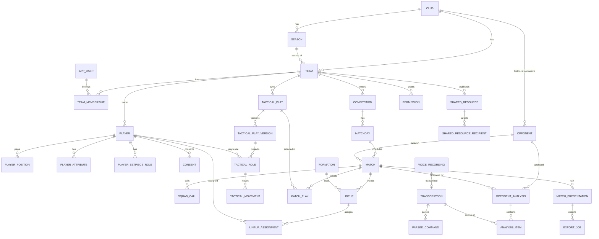

# 12 — Diseño de base de datos

> DDL completo: [`db/schema.sql`](db/schema.sql). **Verificado**: el script carga sin errores en PostgreSQL 16 (36 tablas) en el entorno de diseño. ORM previsto: Drizzle (ADR‑004).

## 1. Principios

1. **Relacional para lo que se consulta, JSONB para lo que se versiona.** Plantilla, calendario, permisos y alineaciones son relacionales. El documento de jugada (`fcs.play/1`) es JSONB inmutable por versión, con **proyecciones relacionales** (`tactical_role`, `tactical_movement`) para búsquedas ("¿en qué jugadas participa Lucas?").
2. **El histórico del rival pertenece al club**, no a la temporada ni al equipo: `opponent.club_id`.
3. **Inmutabilidad + log**: `tactical_play_version` nunca se actualiza; `parsed_command` guarda IR, parche e inverso.
4. **Minimización**: año de nacimiento en vez de fecha para jugadores; foto solo con consentimiento; altura opcional.
5. **Multi‑inquilino por `team_id`/`club_id`** en todas las tablas de negocio, con RLS como segunda barrera.

## 2. Correspondencia con las entidades pedidas

| Entidad pedida | Tabla(s) | Nota |
|---|---|---|
| User | `app_user` | Autenticación delegada (Supabase Auth); aquí perfil |
| Club | `club`, `club_admin` | |
| Team | `team`, `preferred_formation` | `preferences` JSONB = preferencias `TEAM_PREF` del motor |
| Season | `season` | |
| Competition | `competition` | Varias por equipo (liga, copa, amistosos) |
| Player | `player`, `player_attribute`, `player_setpiece_role` | Características y roles ABP extensibles por clave |
| PlayerPosition | `player_position` | Un único `is_primary` (índice parcial) |
| StaffMember | `team_membership` (rol de staff + `staff_title`) | Una tabla para staff, jugadores y tutores |
| Formation | `formation` | Catálogo del sistema (`team_id NULL`) y personalizadas |
| Lineup / LineupAssignment | `lineup`, `lineup_assignment` | `UNIQUE (lineup_id, player_id)` impide duplicados |
| Match / Matchday | `match`, `matchday`, `squad_call` | `BYE`, aplazados (`original_kickoff_at`) |
| Opponent / OpponentAnalysis | `opponent`, `opponent_analysis`, `analysis_item` | Trazabilidad: fuente, fecha observada, span de transcripción |
| TacticalPlay / Version | `tactical_play`, `tactical_play_version` | Variantes vía `variant_of` |
| TacticalRole / TacticalMovement | `tactical_role`, `tactical_movement` | Proyecciones de la versión |
| VoiceRecording / Transcription / ParsedCommand | `voice_recording`, `transcription`, `parsed_command` | |
| MatchPresentation | `match_presentation`, `export_job` | |
| SharedResource / Permission | `shared_resource`, `shared_resource_recipient`, `permission` | |
| (añadidas) | `consent`, `audit_log`, `match_play` | Menores, auditoría, jugadas por jornada |

## 3. Diagrama entidad‑relación

Versión ampliada con atributos: `diagrams/erd.md`.

## 4. Restricciones de integridad relevantes

| Regla de negocio | Implementación |
|---|---|
| Dorsal único por equipo | `player_shirt_uq` (parcial, ignora borrados) |
| Una posición principal | `player_one_primary` |
| Un jugador no aparece dos veces en una alineación | `UNIQUE (lineup_id, player_id)` |
| Un único once oficial por partido | `lineup_one_primary` |
| Jornada sin partido no tiene rival | `CHECK (status <> 'BYE' OR opponent_id IS NULL)` |
| Dimensiones de campo reglamentarias | `CHECK` en `team.pitch_*` |
| Exportación reproducible y cacheable | `export_cache (input_hash, format)` |
| 11 jugadores, 1 portero | Validado por el motor (LINEUP‑01/03); no en BD porque los borradores pueden estar incompletos |

## 5. Índices y patrones de acceso

| Consulta | Índice |
|---|---|
| Próximos partidos del equipo | `match_team_date_idx` |
| Histórico contra un rival | `match_opponent_idx`, `analysis_opponent_idx (opponent_id, observed_on DESC)` |
| Resolver nombres en voz / búsqueda difusa | `player_name_trgm`, `opponent_trgm` (pg_trgm) |
| "Alineación guardada contra el Sporting B" | `lineup_team_tags` (GIN) + join a `match.opponent_id` |
| Jugadas por tipo | `play_team_type` |
| Jugadas en las que participa un jugador | `tactical_role_player` |
| Historial de comandos de un documento | `parsed_cmd_target` |
| Purga de audio | `voice_purge_idx` (parcial) |
| Feed del jugador | `shared_team_idx` + `shared_resource_recipient` |

Volumen esperado (2.000 entrenadores activos, 1 temporada): ~40 k jugadores, ~70 k partidos, ~200 k versiones de jugada (JSON ≈ 8 KB → 1,6 GB), ~2 M comandos. Holgado para una instancia gestionada pequeña.

## 6. Versionado

| Objeto | Estrategia |
|---|---|
| Jugada | Versiones inmutables numeradas; `current_version` en la cabecera; variantes como jugadas hijas (`variant_of`); compartir fija `resource_version` |
| Alineación | Fila mutable con `revision` (bloqueo optimista: `UPDATE … WHERE revision = $n`); historial vía `parsed_command` + `audit_log`. Guardar "como alternativa" crea otra fila |
| Presentación | `outline` mutable con `revision`; cada exportación queda en `export_job` con `input_hash` |
| Análisis | Ítems nunca se sobrescriben al cambiar de opinión: `supersedes_id` y `evidence` (OBSERVED → CONFIRMED/REFUTED) |
| Catálogo del motor | `engine_version`/`catalog_version` en cada versión de jugada |

## 7. Auditoría

`audit_log` registra: cambios de ficha (especialmente los originados por aclaraciones de voz), publicaciones, comparticiones, revocaciones, exportaciones descargadas, cambios de permisos y consentimientos. `diff` almacena antes/después con datos personales minimizados (ids, no textos libres). Retención: 2 años.

## 8. Política de conservación

| Dato | Retención | Mecanismo |
|---|---|---|
| Audio de voz | 30 días por defecto (0–90 configurable por club) | `purge_after`; job diario borra el objeto y pone `storage_key = NULL` |
| Transcripciones y comandos | Mientras exista el elemento asociado; máx. 3 temporadas | Job de temporada |
| Corpus de mejora (texto seudonimizado) | 3 años, solo con consentimiento `VOICE_CORPUS` | Tabla separada fuera del esquema de producción |
| Jugadores | Hasta baja del jugador + 1 temporada (histórico de alineaciones) → anonimización (nombre → "Jugador 7") | Job de fin de temporada |
| Cuenta eliminada | Borrado lógico inmediato; físico a 30 días | Job |
| Copias de seguridad | 35 días (PITR) | Proveedor |
| Auditoría | 2 años | Partición mensual (V1.5) |

## 9. Migraciones

Drizzle Kit genera migraciones SQL revisadas en PR. Reglas: solo migraciones aditivas en caliente; columnas nuevas `NULL` o con `DEFAULT`; borrados en dos despliegues; `schema.sql` de este documento es la referencia de la migración `0001`.
