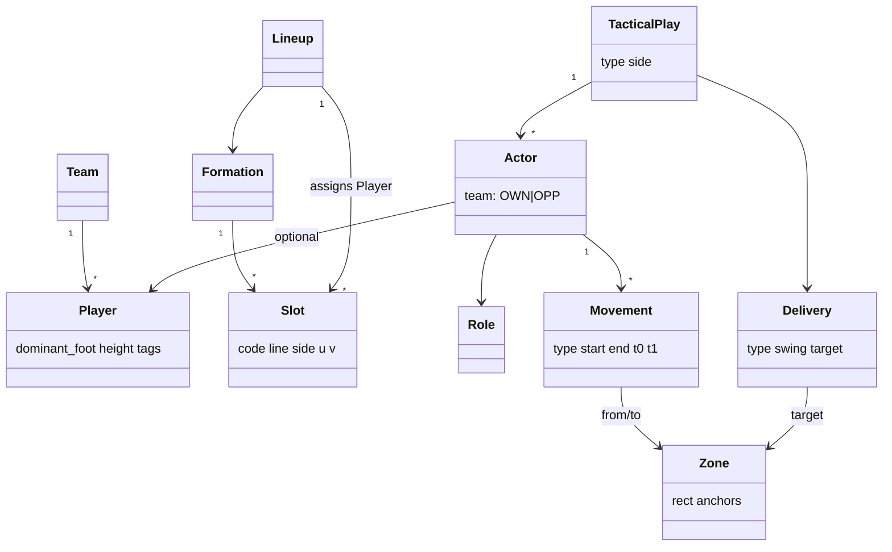

# 14 — Modelo de dominio futbolístico (ontología)

> Este documento define el **vocabulario cerrado** que comparten la base de datos (12), el motor de reglas (15), el motor de voz (16) y la interfaz. Cualquier concepto que no esté aquí no puede ser producido por el motor. Los ficheros máquina son `docs/engine/rules/*.yaml`.

## 1. Sistema de coordenadas

### 1.1 Marco canónico: "marco de ataque" (AF, *attacking frame*)

Toda posición se almacena en el marco del equipo que ataca en la acción (en córner defensivo, el marco sigue siendo el **del equipo propio**, que defiende la portería `u = 0`).

| Eje | Símbolo | Rango | Significado |
|---|---|---|---|
| Longitudinal | `u` | 0 → 1 | De la línea de gol propia a la línea de gol rival |
| Transversal | `v` | 0 → 1 | De la banda **izquierda** a la banda **derecha**, mirando hacia la portería rival |

- Se permite el margen `[-0.04, 1.04]` en ambos ejes para posiciones fuera del terreno (lanzador detrás del balón, saque de banda).
- Las coordenadas se redondean a **4 decimales** (≈ 1 cm en 105 m) en cada operación para garantizar determinismo entre plataformas.
- Conversión a metros: `x = u · L`, `y = v · W`, con `L × W` = dimensiones del campo de la jugada (por defecto **105 × 68 m**, configurable por equipo; rango reglamentario de fútbol 11 internacional 100–110 × 64–75 m, nacional 90–120 × 45–90 m).
- **El motor calcula en metros y almacena normalizado.** Así "un metro a la izquierda" es exactamente 1 m sea cual sea la pantalla.

### 1.2 Lateralidad

"Izquierda/derecha" se interpretan **siempre en el marco de ataque** (como habla el entrenador: "banda izquierda", "córner desde la izquierda"). El entrenador puede cambiar en Preferencias a "izquierda de la pantalla"; el valor se guarda en `user.direction_frame` y se registra en cada comando (`reference_frame`).

### 1.3 Vistas

| Vista | Uso | Transformación pantalla (sx, sy ∈ [0,1]) |
|---|---|---|
| Vertical, ataque hacia arriba (por defecto en móvil) | Alineación, ABP | `sx = v`, `sy = 1 − u` → izquierda AF = izquierda de pantalla |
| Horizontal, ataque a la derecha (por defecto en tableta/escritorio) | Editor | `sx = u`, `sy = v` |
| Medio campo ofensivo | ABP ofensivo | recorte `u ∈ [0.5, 1.04]` |
| Medio campo defensivo | ABP defensivo | recorte `u ∈ [−0.04, 0.5]` |

## 2. Referencias geométricas (metros, AF, campo 105 × 68)

Medidas reglamentarias (Regla 1): portería 7,32 m; área de meta 5,5 m; área de penalti 16,5 m; punto de penalti a 11 m; arco a 9,15 m del punto; cuadrante de esquina radio 1 m.

| Id | Elemento | Coordenadas (portería rival) |
|---|---|---|
| `GOAL_C` | Centro de portería | (105, 34) |
| `POST_L` / `POST_R` | Postes | (105, 30.34) / (105, 37.66) |
| `GA` | Área de meta | x ∈ [99.5, 105], y ∈ [24.84, 43.16] |
| `PA` | Área de penalti | x ∈ [88.5, 105], y ∈ [13.84, 54.16] |
| `PEN_SPOT` | Punto de penalti | (94, 34) |
| `CORNER_L` / `CORNER_R` | Esquinas | (105, 0) / (105, 68) |

Todas las referencias de la portería propia se obtienen por simetría `x' = L − x`.

### 2.1 "Primer palo" y "segundo palo" son relativos al origen del balón

`near_post(side)` = poste más cercano al lado del lanzamiento. Córner izquierdo (`v = 0`) → `POST_L`; córner derecho → `POST_R`. Las zonas de ABP se definen **una sola vez para el lado izquierdo** y se reflejan con `y' = W − y` (`mirror_v`). Esto elimina una clase entera de errores.

## 3. Zonas

Una zona es un rectángulo o polígono en metros con **anclas ordenadas** (puntos de colocación deterministas). Extracto (fichero completo: `rules/zones.yaml`):

| Id | Nombre (es) | Sinónimos de voz | Rect (lado izquierdo) | Anclas |
|---|---|---|---|---|
| `Z_NEAR_POST` | Primer palo | "primer palo", "palo corto", "primero" | x 99.5–105, y 26–32.5 | (101.5, 30.5), (100, 29), (102.5, 31.8) |
| `Z_FAR_POST` | Segundo palo | "segundo palo", "palo largo" | x 99.5–105, y 36–42.5 | (101.5, 39.5), (100, 41), (102.8, 38) |
| `Z_GA_CENTER` | Centro del área pequeña | "centro del área chica", "el seis" | x 100–105, y 32.5–36 | (102, 34.2), (100.5, 33.2) |
| `Z_PEN_SPOT` | Punto de penalti | "el punto", "penalti" | x 92–97, y 30–38 | (94, 34), (95.5, 36.5), (95.5, 31.5) |
| `Z_FAR_ZONE` | Fuera del segundo palo | "lejos", "zona de segundo palo abierta" | x 96–101, y 42.5–49 | (98.5, 45), (97, 47.5) |
| `Z_EDGE` | Frontal del área | "la frontal", "borde del área" | x 83–88.5, y 24–44 | (86, 34), (86, 29), (86, 39) |
| `Z_REBOUND` | Zona de rechace | "rechace", "segunda jugada" | x 82–89, y 20–48 | (86.5, 30), (86.5, 38), (84, 24), (84, 44) |
| `Z_GK` | Portero rival | "encima del portero", "molestar al portero" | x 103.5–105, y 32–36 | (104, 34.6) |
| `Z_SHORT` | Opción de corto | "en corto", "para el corto" | x 94–103, y 0–8 | (100, 5), (97, 7) |
| `Z_REST` | Vigilancia | "atrás", "vigilancia", "quedarse" | x 55–72, y 10–58 | (65, 24), (65, 44), (60, 34) |
| `Z_START_CLUSTER` | Salida agrupada | "en grupo", "racimo", "todos juntos" | x 90–94, y 34–42 | (92, 36), (92.5, 38), (91.5, 40), (93, 41) |

Reglas de colocación: separación mínima entre compañeros **1,0 m**; si un ancla viola la separación se usa la siguiente; agotadas las anclas, se genera rejilla de 1 m dentro del rectángulo en orden (x desc, |y − ancla₀.y| asc). Totalmente determinista.

## 4. Posiciones de alineación

Códigos internos en inglés, etiquetas en español:

| Código | Etiqueta | Abrev. | Línea | Lado |
|---|---|---|---|---|
| `GK` | Portero | POR | GK | C |
| `RB` / `LB` | Lateral derecho / izquierdo | LD / LI | DEF | R / L |
| `RWB` / `LWB` | Carrilero derecho / izquierdo | CAD / CAI | DEF (o MID en 3‑5‑2) | R / L |
| `CB` | Central | DFC | DEF | L / C / R (por instancia) |
| `DM` | Mediocentro defensivo (pivote) | MCD | MID | C (L/R en doble pivote) |
| `CM` | Mediocentro / interior | MC | MID | L / C / R |
| `RM` / `LM` | Medio derecho / izquierdo | MD / MI | MID | R / L |
| `AM` | Mediapunta | MCO | MID | C (L/R en 4‑2‑3‑1 son RM/LM o RW/LW) |
| `RW` / `LW` | Extremo derecho / izquierdo | ED / EI | ATT | R / L |
| `ST` | Delantero centro | DC | ATT | C (L/R con dos puntas) |
| `SS` | Segundo delantero | SD | ATT | C |

Una **ranura** (`slot`) es una instancia de posición en una formación: `CB_L`, `CB_R`, `CM_L`, `ST_R`… Grupos semánticos para voz: `centrales = {CB_*}`, `laterales = {RB, LB, RWB, LWB}`, `extremos = {RW, LW}` (y `{RM, LM}` en 4‑4‑2, con confirmación), `en el medio = línea MID`, `arriba = línea ATT`, `atrás/defensa = línea DEF`.

## 5. Formaciones

Una formación es una lista ordenada de ranuras con coordenadas base (bloque medio, AF). Catálogo MVP: `4-3-3`, `4-4-2`, `4-2-3-1`, `3-5-2`, `5-3-2`, `4-1-4-1`, `4-4-1-1`, `3-4-3`, `4-3-1-2`, `5-4-1`. Ejemplo `4-3-3` (orden de lectura izquierda→derecha por línea):

| Ranura | u | v |
|---|---|---|
| GK | 0.05 | 0.50 |
| LB | 0.24 | 0.12 |
| CB_L | 0.21 | 0.37 |
| CB_R | 0.21 | 0.63 |
| RB | 0.24 | 0.88 |
| CM_L | 0.42 | 0.30 |
| DM | 0.36 | 0.50 |
| CM_R | 0.42 | 0.70 |
| LW | 0.62 | 0.14 |
| ST | 0.66 | 0.50 |
| RW | 0.62 | 0.86 |

Formaciones personalizadas: el entrenador mueve ranuras; se guarda como `formation` con `is_custom = true`, base = formación de origen.

## 6. Fases y situaciones del juego

| Código | Fase |
|---|---|
| `ORG_ATT` | Organización ofensiva |
| `ORG_DEF` | Organización defensiva |
| `TRANS_ATT_DEF` | Transición ataque → defensa |
| `TRANS_DEF_ATT` | Transición defensa → ataque |
| `SP_ATT` | Balón parado ofensivo |
| `SP_DEF` | Balón parado defensivo |

Tipos de acción a balón parado:

| Código | Acción | Disponible |
|---|---|---|
| `CORNER_ATT` / `CORNER_DEF` | Córner ofensivo / defensivo | Piloto |
| `FK_WIDE_ATT` / `FK_WIDE_DEF` | Falta lateral | V1 |
| `FK_CENTRAL_ATT` / `FK_CENTRAL_DEF` | Falta frontal (directa) | V1 |
| `FK_INDIRECT_ATT` / `FK_INDIRECT_DEF` | Falta indirecta | V1 |
| `THROW_IN_ATT` / `THROW_IN_DEF` | Saque de banda | V1 |
| `KICKOFF` | Saque de centro | V1 |
| `CUSTOM` | Otra situación (editor libre, sin plantillas) | V1 |

## 7. Golpeos (entregas de balón)

| Código | Nombre | Sinónimos | Parámetros |
|---|---|---|---|
| `INSWING` | Cerrado (hacia portería) | "cerrado", "cerrada", "hacia dentro", "a pierna cambiada" | curvatura hacia la portería |
| `OUTSWING` | Abierto (alejándose) | "abierto", "abierta", "hacia fuera", "a pierna natural" | curvatura hacia fuera |
| `DRIVEN` | Tenso | "tenso", "fuerte", "raso‑tenso" | velocidad visual 22 m/s, arco bajo |
| `LOFTED` | Bombeado | "bombeado", "colgado", "por arriba" | velocidad visual 14 m/s, arco alto |
| `SHORT` | Corto | "en corto", "corto" | pase raso a `Z_SHORT` |
| `LOW` | Raso | "raso", "por abajo" | pase raso |

Destinos: `Z_NEAR_POST`, `Z_FAR_POST`, `Z_GA_CENTER`, `Z_PEN_SPOT`, `Z_FAR_ZONE`, `Z_EDGE`, `Z_SHORT`.

**Relación lado–pierna–efecto (regla TECH‑SWING‑01)**: con golpeo de interior, el efecto natural es *cerrado* si el pie es el contrario a la banda de lanzamiento (diestro desde la izquierda, zurdo desde la derecha) y *abierto* si coincide. "A pierna cambiada" ≡ cerrado. Un golpeo de exterior invierte la relación (se modela como `technique: OUTSIDE_FOOT`, poco frecuente; requiere confirmación). Jugador ambidiestro: compatible con ambos.

## 8. Roles

| Código | Rol | Fase | Descripción operativa | Movimientos permitidos |
|---|---|---|---|---|
| `TAKER` | Lanzador | ABP | Golpea el balón | — |
| `PRIMARY_TARGET` | Rematador principal | ABP_ATT | Destinatario previsto del balón | ATTACK_* , CROSS_RUN, LATE_ARRIVAL |
| `SECONDARY_TARGET` | Rematador secundario | ABP_ATT | Ataca otra zona de remate | ATTACK_*, CROSS_RUN |
| `BLOCKER` | Bloqueador (pantalla) | ABP_ATT | Ocupa la trayectoria de un defensor sin contacto | SCREEN |
| `DECOY` | Jugador de arrastre | ABP_ATT | Arrastra a su marcador fuera de la zona objetivo | DECOY_RUN |
| `SHORT_RECEIVER` | Receptor de saque corto | ABP_ATT | Ofrece la opción corta | SHORT_OPTION |
| `REBOUND` | Rechace | ABP_ATT | Espera segundas jugadas en la frontal | HOLD, LATE_ARRIVAL |
| `REST_DEFENDER` | Vigilancia | ABP_ATT | Controla la contra rival | HOLD |
| `GK_SCREEN` | Molestar al portero | ABP_ATT | Se sitúa junto al portero rival | HOLD |
| `COVER` | Cobertura | ABP | Equilibrio entre rechace y vigilancia | HOLD |
| `ZONAL_DEFENDER` | Defensor en zona | ABP_DEF | Defiende un espacio | HOLD, ATTACK_BALL |
| `MAN_MARKER` | Marcador individual | ABP_DEF | Sigue a un rival concreto | FOLLOW |
| `POST_GUARD` | Hombre de palo | ABP_DEF | Protege un poste | HOLD |
| `EDGE_GUARD` | Defensor de frontal | ABP_DEF | Controla rechaces | HOLD |
| `COUNTER_OUTLET` | Salida a la contra | ABP_DEF | Se queda arriba para contraatacar | HOLD |
| `WALL` | Barrera | FK_DEF | Forma la barrera | HOLD |
| `GOALKEEPER` | Portero | todas | — | — |

## 9. Movimientos

Cada movimiento define: zona de inicio por defecto, zona final, forma de trayectoria, perfil de velocidad y ancla temporal (fichero: `rules/movements.yaml`).

| Código | Nombre (es) | Sinónimos | Inicio por defecto | Fin | Forma | Velocidad | Ancla temporal |
|---|---|---|---|---|---|---|---|
| `ATTACK_NEAR_POST` | Ataque al primer palo | "atacar el primer palo", "entrar al primero" | Z_START_CLUSTER | Z_NEAR_POST | curva hacia portería | sprint 7 m/s | llega en `BALL_ARRIVAL` |
| `ATTACK_FAR_POST` | Ataque al segundo palo | "atacar el segundo palo" | Z_PEN_SPOT | Z_FAR_POST | recta | sprint | llega en `BALL_ARRIVAL` |
| `ATTACK_PEN_SPOT` | Ataque al punto de penalti | "al punto" | Z_EDGE | Z_PEN_SPOT | recta | sprint | llega en `BALL_ARRIVAL` |
| `ATTACK_GA_CENTER` | Ataque al centro del área pequeña | "al centro", "al seis" | Z_PEN_SPOT | Z_GA_CENTER | recta | sprint | llega en `BALL_ARRIVAL` |
| `RUN_IN_BEHIND` | Desmarque de ruptura | "atacar el espacio", "a la espalda" | posición actual | zona destino | recta | sprint | inicia en `KICK − 0.2 s` |
| `DECOY_RUN` | Movimiento de arrastre | "arrastrar a su marca", "llevarse al defensor" | posición actual | zona alejada del objetivo | recta | trote‑sprint 6 m/s | inicia en `KICK − 0.6 s` |
| `SCREEN` | Bloqueo posicional | "bloqueo", "pantalla", "hacer la pantalla", "bloquear" | posición actual | punto de bloqueo calculado | recta corta | 4 m/s, **estático al llegar** | llega antes de que el beneficiario inicie su carrera |
| `CROSS_RUN` | Movimiento cruzado | "cruzarse", "cruce" | pareja | zonas intercambiadas | curvas opuestas | sprint | sincronizado con el compañero |
| `LATE_ARRIVAL` | Llegada desde segunda línea | "entrar desde atrás", "llegar de segunda línea" | Z_EDGE | Z_PEN_SPOT | recta | sprint | llega en `BALL_ARRIVAL + 0.3 s` |
| `CHECK_TO_BALL` | Venir a recibir | "venir a recibir", "dar apoyo" | posición actual | hacia el balón 6 m | recta | 5 m/s | inicia en `KICK − 0.5 s` |
| `SHORT_OPTION` | Ofrecer el corto | "para el corto" | Z_SHORT lejos | Z_SHORT cerca | recta | 5 m/s | inicia en `KICK − 1.0 s` |
| `HOLD` | Mantener posición | "quedarse", "esperar", "aguantar" | posición | posición | — | — | — |
| `FOLLOW` | Seguir a un rival | "marcar a", "seguir a" | posición | posición del rival a lo largo del tiempo | derivada | igual al rival | sincronizado |

## 10. Relaciones

| Relación | Dominio → Rango | Ejemplo |
|---|---|---|
| `marks(defender, attacker)` | rival → propio | El 4 rival marca a nuestro 5 |
| `screens(blocker, defender, beneficiary)` | propio, rival, propio | Diego bloquea al marcador de Mateo |
| `crosses_with(a, b)` | propio, propio | Cruce entre 5 y 9 |
| `precedes(movement_a, movement_b, gap_s)` | movimiento, movimiento | Bloqueo antes que carrera (≥ 0,3 s) |
| `delivers_to(ball, zone)` | balón, zona | Balón al segundo palo |
| `plays_in(player, slot)` | jugador, ranura | Pablo en GK |

## 11. Intensidades y magnitudes (tabla configurable por equipo)

| Expresión | Distancia | Tiempo | Compactación |
|---|---|---|---|
| "un poquito", "algo" | 1,5 m | 0,2 s | 5 % |
| "un poco" | 3 m | 0,3 s | 10 % |
| (sin modificador) | 3 m | 0,5 s | 15 % |
| "bastante", "más" | 5 m | 0,7 s | 15 % |
| "mucho" | 8 m | 1,0 s | 25 % |
| cifra explícita ("un metro", "dos metros y medio") | literal | literal | literal |

Las cifras explícitas siempre prevalecen. Las magnitudes cualitativas se muestran en la revisión ("Adelantar extremos 3 m — *un poco*") para que el entrenador las vea y ajuste.

## 12. Diagrama de la ontología

