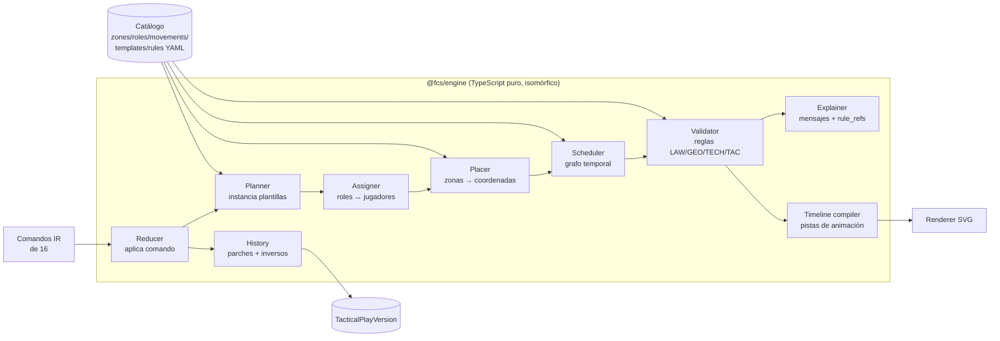

# 15 — Motor táctico determinista (Tactical Rules Engine)

> Documento técnico principal. Responde a: *¿cómo un entrenador describe verbalmente una jugada y la aplicación la representa, modifica y reproduce sin IA generativa?* La parte lingüística (texto → comandos) está en 16; aquí se trata **comandos → jugada → animación**.

## 1. Garantías del motor

| # | Garantía | Cómo se asegura |
|---|---|---|
| G1 | **Determinismo**: mismo documento + mismo comando + misma versión de motor y catálogo ⇒ mismo resultado byte a byte | Funciones puras, sin `Math.random`, sin reloj, orden estable, redondeo a 4 decimales, serialización canónica (claves ordenadas) |
| G2 | **Localidad**: un comando solo modifica las entidades que nombra o de las que dependen explícitamente | Cada reductor declara su `touchSet`; test de propiedad: `diff(doc, doc') ⊆ touchSet` |
| G3 | **Reversibilidad**: todo comando tiene inverso exacto | Se almacena el parche JSON (RFC 6902) y su inverso |
| G4 | **Explicabilidad**: cada colocación, valor por defecto o advertencia referencia una regla con id | Campo `provenance` y `rule_refs` en cada entidad y mensaje |
| G5 | **Nada inventado**: lo no expresado se rellena solo con reglas de catálogo y se marca `origin = DEFAULT` | Validador rechaza entidades sin `origin` |
| G6 | **Sin IA generativa**: el motor no llama a ningún modelo | El paquete `@fcs/engine` no tiene dependencias de red; lint que prohíbe `fetch` |

## 2. Alternativas evaluadas

| Opción | Ejemplos | Determinismo | Predicados espaciales | Explicabilidad | Ejecución en navegador | Coste de desarrollo | Veredicto |
|---|---|---|---|---|---|---|---|
| A. LLM que genera la jugada | GPT/Claude con *prompt* | ✘ (variación, alucinación) | ~ | ✘ | ✘ (red) | Bajo inicial, alto de control | **Descartada** por principio del proyecto |
| B. Sistema de reglas de producción genérico | Drools (JVM), CLIPS, `json-rules-engine` | ✔ | ✘ (hechos planos, la geometría se escribe fuera) | ~ (traza de reglas disparadas) | Solo `json-rules-engine` | Medio | Descartada como núcleo: aporta encadenamiento que no necesitamos y obliga a codificar geometría como hechos |
| C. Solver de restricciones | OR‑Tools CP‑SAT, MiniZinc | ✔ (con semilla y límite) | ✔ (discretizado) | ✘ (soluciones opacas) | ✘ (WASM pesado) | Alto | Descartada para el MVP; reconsiderar en V2 para *sugerir* colocaciones defensivas óptimas |
| D. Programación lógica | Prolog, Datalog (Soufflé) | ✔ | ~ | ✔ | ~ (Tau‑Prolog) | Alto (perfil escaso) | Descartada por mantenibilidad del equipo |
| E. **DSL declarativo propio + reglas tipadas + algoritmos específicos** | Plantillas YAML compiladas; reglas en TypeScript con metadatos; algoritmo húngaro; planificador temporal | ✔ | ✔ (código nativo) | ✔ (ids y mensajes) | ✔ | Medio | **Elegida** |

**Por qué E**: el dominio es pequeño y cerrado (≤ 22 jugadores, ≤ 30 movimientos, ~15 zonas), el valor está en la geometría y la temporización (mal servidas por motores genéricos) y necesitamos ejecutar el mismo código en el navegador (edición instantánea y sin conexión) y en el servidor (validación autoritativa). Los entrenadores‑asesores editan **datos** (plantillas YAML), no código.

## 3. Arquitectura interna



| Módulo | Entrada | Salida | Notas |
|---|---|---|---|
| `catalog` | YAML (`docs/engine/rules`) | Objetos inmutables tipados | Se compila en *build*; versión `catalog_version` (semver) |
| `reducer` | `PlayDoc`, `Command` | `PlayDoc'`, `Patch`, `InversePatch`, `Diagnostics` | Punto de entrada único |
| `planner` | `CreatePlay` + plantilla | Esqueleto: actores, roles, movimientos | Fusión explícito > preferencia > defecto |
| `assigner` | Roles sin jugador, plantilla disponible | Asignación rol↔jugador | Algoritmo húngaro sobre matriz de idoneidad |
| `placer` | Actores con zona | Coordenadas | Anclas + separación mínima |
| `scheduler` | Movimientos con anclas temporales | `t_start`, `t_end` por movimiento | Grafo de precedencias + sincronización con el balón |
| `validator` | `PlayDoc` | `Diagnostic[]` | Reglas puras `(doc, ctx) => Diagnostic[]` |
| `timeline` | `PlayDoc` | `Timeline` (pistas con *keyframes*) | Consumido por el renderer y por exportación |
| `explainer` | Diagnósticos, provenance | Texto en español | Plantillas de mensaje por regla |

## 4. Documento de jugada (`PlayDoc`)

Esquema completo: `docs/engine/play.schema.json`. Resumen:

```jsonc
{
  "schema": "fcs.play/1",
  "engine_version": "1.0.0",
  "catalog_version": "1.0.0",
  "type": "CORNER_ATT",
  "side": "LEFT",
  "pitch": { "length_m": 105, "width_m": 68 },
  "delivery": {
    "taker_actor": "a1", "type": "INSWING", "trajectory": "DRIVEN",
    "target_zone": "Z_FAR_POST", "target_point": { "u": 0.9667, "v": 0.5809 },
    "kick_t": 0.0, "arrival_t": 1.6,
    "provenance": { "type": "EXPLICIT", "swing": "EXPLICIT", "target_zone": "EXPLICIT", "trajectory": "DEFAULT" }
  },
  "actors": [
    {
      "id": "a1", "team": "OWN", "player_id": "pl_7", "label": "7",
      "role": "TAKER", "start": { "u": 1.0, "v": 0.0 },
      "provenance": { "role": "EXPLICIT", "player_id": "EXPLICIT", "start": "RULE:CRN-POS-01" },
      "locked": false
    }
  ],
  "movements": [
    {
      "id": "m3", "actor": "a3", "type": "ATTACK_FAR_POST",
      "path": [{ "u": 0.8952, "v": 0.5294 }, { "u": 0.9667, "v": 0.5809 }],
      "shape": "STRAIGHT", "speed_mps": 7.0,
      "t_start": 0.45, "t_end": 1.6, "depends_on": ["m4"],
      "provenance": { "type": "EXPLICIT", "timing": "RULE:SCH-SYNC-01" }
    }
  ],
  "relations": [ { "type": "SCREENS", "blocker": "a4", "defender": "o2", "beneficiary": "a3" } ],
  "notes": [ { "id": "n1", "text": "Bloqueo sin contacto, llegar parado.", "origin": "EXPLICIT" } ],
  "diagnostics": []
}
```

`provenance` admite: `EXPLICIT` (lo dijo o hizo el entrenador), `TEAM_PREF` (preferencia guardada del equipo), `RULE:<id>` (valor por defecto del catálogo), `MANUAL` (arrastre en el editor). La UI dibuja con borde **discontinuo** todo actor o movimiento cuyo campo principal no sea `EXPLICIT` o `MANUAL`.

## 5. DSL de plantillas (FCS‑Play)

Las plantillas son datos YAML validados por JSON Schema. Ejemplo resumido (completo en `rules/templates.yaml`):

```yaml
template: CRN_ATT_STANDARD
type: CORNER_ATT
version: 1.0.0
params:
  side:        { enum: [LEFT, RIGHT], required: true }
  delivery:    { enum: [INSWING, OUTSWING, SHORT], default: from_taker_foot }
  trajectory:  { enum: [DRIVEN, LOFTED], default: DRIVEN }
  target_zone: { enum: [Z_NEAR_POST, Z_FAR_POST, Z_GA_CENTER, Z_PEN_SPOT], default: Z_FAR_POST }
role_defaults:            # se usan SOLO para huecos no especificados
  TAKER:           { count: 1 }
  PRIMARY_TARGET:  { count: 1, movement: ATTACK_TO_TARGET, start_zone: Z_START_CLUSTER }
  SECONDARY_TARGET:{ count: 2, movements: [ATTACK_NEAR_POST, ATTACK_PEN_SPOT], start_zone: Z_START_CLUSTER }
  DECOY:           { count: 1, movement: DECOY_RUN, start_zone: Z_START_CLUSTER }
  GK_SCREEN:       { count: 1, start_zone: Z_GK }
  REBOUND:         { count: 2, start_zone: Z_REBOUND }
  REST_DEFENDER:   { count: 2, start_zone: Z_REST }
fill_order: [TAKER, REST_DEFENDER, PRIMARY_TARGET, BLOCKER, SECONDARY_TARGET, REBOUND, DECOY, GK_SCREEN]
outfield_total: 10
constraints: [LAW-CRN-01, GEO-01, GEO-02, TECH-SWING-01, TAC-CRN-REST-01, SEQ-SCREEN-01]
```

Semántica:

- `role_defaults` solo completa lo que falte tras aplicar lo explícito. Si el entrenador especifica 8 de 10 jugadores de campo, el *planner* recorre `fill_order` y, para cada rol, añade `max(0, count_defecto − count_explícito)` actores hasta llegar a `outfield_total`; los marca `RULE:TPL-CRN_ATT_STANDARD`. Ejemplo 6.3: explícitos TAKER 1, BLOCKER 1, PRIMARY 1, SECONDARY 1, REBOUND 2, REST 2 = 8 → se añaden 1 SECONDARY (ataque al punto de penalti) y 1 DECOY = 10; GK_SCREEN no entra.
- Los defaults suman exactamente 10 (TAKER 1, PRIMARY 1, SECONDARY 2, DECOY 1, GK_SCREEN 1, REBOUND 2, REST 2): "créame un córner desde la izquierda" sin más produce una jugada completa, toda marcada como propuesta.
- Si lo explícito excede 10 jugadores de campo → error `GEO-02` y aclaración (no se recorta en silencio).
- Las plantillas son **extensibles por el club** (V1.5): una copia con otro `fill_order` o zonas.

## 6. Pipeline de creación (los 15 pasos del enunciado)

Entrada (desde 16): comandos `play.create`, `play.set_taker`, `play.set_delivery`, `play.add_roles` ×N, `play.relation`, `play.constraint`.

| Paso | Acción | Módulo | Regla(s) | Resultado ante fallo |
|---|---|---|---|---|
| 1 | Identificar tipo de acción | reducer | — | Sin tipo → aclaración "¿Qué acción: córner, falta, saque de banda?" |
| 2 | Identificar lado | reducer | — | Sin lado → aclaración con 2 opciones (previsualizadas) |
| 3 | Seleccionar lanzador | assigner | ROLE‑TAKER‑01 (preferir jugador con rol ABP `corner_taker_{side}`) | Nombre no resuelto → aclaración (16 §7) |
| 4 | Validar pierna dominante | validator | TECH‑SWING‑01 | Conflicto ficha vs. instrucción → aclaración, **nunca** se edita la ficha sin confirmación |
| 5 | Crear roles | planner | TPL‑* | — |
| 6 | Distribuir jugadores | assigner | ASG‑01..04 | Menos disponibles que roles → advertencia + roles sin asignar |
| 7 | Aplicar posicionamiento | placer | CRN‑POS‑01..08 | — |
| 8 | Comprobar cobertura de roles | validator | GEO‑02, TAC‑CRN‑REST‑01 | Advertencia con propuesta |
| 9 | Resolver conflictos de asignación | assigner | ASG‑03 (un jugador, un rol) | Aclaración si el conflicto viene de lo explícito |
| 10 | Crear trayectorias | planner + placer | MOV‑* | — |
| 11 | Recorrido del balón | scheduler | BALL‑01..03 | — |
| 12 | Secuencia animada | scheduler + timeline | SCH‑* | Ciclo en precedencias → error interno, comando rechazado |
| 13 | Mostrar resultado | UI | — | — |
| 14 | Permitir correcciones | reducer (comandos incrementales) | — | — |
| 15 | Guardar | API | — | Versión inmutable + log de comandos |

## 7. Asignación de jugadores a roles

Problema: `n` roles sin jugador explícito, `m` jugadores disponibles (convocados, no lesionados, no ya asignados explícitamente). Se resuelve con el **algoritmo húngaro** (O(k³), k ≤ 11) maximizando idoneidad.

**Matriz de idoneidad** `S[rol][jugador]` (enteros 0–100, para evitar coma flotante):

| Rol | Factores (peso) |
|---|---|
| `TAKER` | rol ABP `corner_taker_{side}` (60), etiqueta `set_piece_specialist` (30), pie compatible con el golpeo pedido (10) |
| `PRIMARY_TARGET` | etiqueta `aerial` (40), altura normalizada (40), rol ABP `primary_target` (20) |
| `SECONDARY_TARGET` | `aerial` (30), altura (30), `finishing` (20), posición ST/CB (20) |
| `BLOCKER` | `physical` (40), altura (30), posición CB/DM (30) |
| `DECOY` | `pace` (40), posición ST/W (30), `aerial` (30) |
| `REBOUND` | `long_shot` (50), posición CM/AM (50) |
| `REST_DEFENDER` | posición CB/FB/DM (50), `pace` (50) |
| `GK_SCREEN` | `physical` (60), altura (40) |

- Altura ausente → 50 (neutral) y la UI indica "dato no disponible".
- **Desempate determinista**: si existen varias asignaciones con la misma idoneidad total máxima, se elige la que produce el vector de dorsales lexicográficamente menor cuando los actores se ordenan por `fill_order` y, dentro de un rol, explícitos antes que propuestos (después por `player_id`). Se implementa añadiendo a cada celda una penalización ε·rango que no altera el óptimo principal (enteros escalados ×10⁴).
- **Zona de acción**: `play.add_roles {zone}` fija la *zona de acción* del actor (`action_zone`): destino del remate para atacantes, zona de espera para roles estáticos. Los selectores del tipo "los dos del segundo palo" buscan por `action_zone`, no por posición inicial.
- El entrenador puede fijar preferencias por equipo ("Diego siempre bloquea") → `TEAM_PREF`, peso 1000.
- Jugadores nombrados explícitamente quedan **bloqueados** y fuera de la optimización.
- Si no hay plantilla vinculada (jugada genérica de biblioteca), los actores se etiquetan por rol ("R1", "B1") y sin jugador.

## 8. Colocación

1. Para cada rol con `start_zone`, tomar la zona (reflejada si `side = RIGHT`).
2. Ordenar actores de la zona por: actores `EXPLICIT` primero, después por id de rol en `fill_order`, después por dorsal.
3. Asignar anclas en orden, saltando las que incumplen `GEO-SPACING-01` (≥ 1,0 m entre compañeros) o `LAW-*` (distancias reglamentarias de rivales).
4. Rejilla de respaldo de 1 m dentro de la zona (orden descrito en 14 §3).
5. Redondeo a 4 decimales.

Colocaciones especiales:

- **Lanzador (CRN‑POS‑01)**: balón en `CORNER_side` desplazado 0,5 m hacia dentro del cuadrante; lanzador a 2 m detrás del balón con ángulo de carrera de 30° respecto a la línea de fondo.
- **Bloqueador (CRN‑POS‑05)**: punto de bloqueo = punto de la recta *posición del defensor del beneficiario → punto de impacto del beneficiario*, a 1,2 m del defensor. Si no hay rival modelado se usa la posición estándar del marcador (1 m goal‑side y 0,5 m hacia el balón del atacante) — marcada `DEFAULT`.
- **Vigilancia (CRN‑POS‑07)**: `u ≤ 0.70` (≥ 31,5 m de la portería rival) y separados ≥ 15 m en `y`, un jugador por mitad del campo si son dos.

## 9. Temporización y sincronización (scheduler)

Modelo: **grafo de eventos** con tiempos relativos al golpeo `KICK = 0 s`.

- Eventos fijos: `KICK` (0), `BALL_ARRIVAL` = `KICK + d / v_ball` (d = longitud de la curva del balón, `v_ball` según trayectoria: DRIVEN 22 m/s, LOFTED 14 m/s, SHORT/LOW 12 m/s). Velocidades **visuales**, no físicas.
- Cada movimiento tiene una ancla: `starts_at(event ± Δ)` o `arrives_at(event ± Δ)`. Duración = longitud / velocidad (`walk` 2, `jog` 4, `run` 5,5, `sprint` 7 m/s).
- Restricciones:
  - `SCH-SYNC-01`: el objetivo principal llega al punto de destino del balón en `BALL_ARRIVAL ± 0,15 s`.
  - `SEQ-SCREEN-01`: el bloqueador está **parado** en el punto de bloqueo al menos 0,3 s antes de que el beneficiario pase por la línea del defensor.
  - `SCH-NEG-01`: ningún movimiento empieza antes de `KICK − 2,5 s` (la jugada empieza en `t = −2,5 s`).
- Resolución: orden topológico (Kahn con cola ordenada por id → determinista), luego se calcula `t_start`/`t_end`. Si una restricción no se puede cumplir (p. ej. el bloqueador no llega a tiempo), se adelanta su inicio hasta el límite y, si sigue sin cumplirse, se emite advertencia `SEQ-SCREEN-01` con propuesta concreta ("empezar el bloqueo 0,4 s antes" o "acercar el punto de partida 2 m").

Ejemplo "El bloqueo tiene que empezar antes": comando `play.shift_timing {target: movement(role=BLOCKER), delta_s: −0.5}` → nueva ancla `starts_at(KICK − 1.1)`; el scheduler recalcula **solo** ese movimiento y los que dependen de él (`depends_on`), y valida `SEQ-SCREEN-01`.

## 10. Catálogo de reglas de validación (MVP)

Formato: `id · clase · severidad · descripción · origen`. Fichero: `rules/constraints.yaml`.

| Id | Clase | Sev. | Regla |
|---|---|---|---|
| GEO‑01 | GEOMETRY | error | Todo actor dentro de `[-0.04, 1.04]²` |
| GEO‑02 | GEOMETRY | error | ≤ 11 actores por equipo; ≤ 1 portero por equipo |
| GEO‑03 | GEOMETRY | error | Un jugador real no aparece en dos actores |
| GEO‑SPACING‑01 | GEOMETRY | aviso | ≥ 1,0 m entre compañeros en t = −2,5 s |
| GEO‑PATH‑01 | GEOMETRY | aviso | Trayectoria no sale del terreno (salvo lanzador) |
| AVAIL‑01 | ROSTER | aviso | Jugador asignado marcado como lesionado/sancionado/no convocado |
| LAW‑CRN‑01 | LAW (R17) | error | Balón en el cuadrante del lado indicado |
| LAW‑CRN‑02 | LAW (R17) | aviso | Rivales a ≥ 9,15 m del cuadrante hasta el golpeo |
| LAW‑CRN‑03 | LAW (R17) | aviso | El lanzador no vuelve a tocar el balón antes que otro jugador (detecta jugadas "pared" mal secuenciadas) |
| LAW‑FK‑01 | LAW (R13) | aviso | Rivales a ≥ 9,15 m del balón |
| LAW‑FK‑02 | LAW (R13) | aviso | Con barrera de ≥ 3 defensores, atacantes a ≥ 1 m de la barrera |
| LAW‑TI‑01 | LAW (R15) | aviso | Rivales a ≥ 2 m del punto del saque de banda |
| LAW‑KO‑01 | LAW (R8) | aviso | Todos en su propio campo y rivales a ≥ 9,15 m en el saque inicial |
| LAW‑OFF‑INFO | LAW (R11) | info | Informativo: no hay fuera de juego si se recibe directamente de córner o saque de banda; sí en faltas |
| LAW‑IMP‑01 | LAW (R12) | aviso | Bloqueo con desplazamiento hacia el rival en los 0,3 s previos al paso del defensor ⇒ "riesgo de sanción por impedir el avance" |
| TECH‑SWING‑01 | TECHNIQUE | aviso | Golpeo pedido incompatible con pie dominante y lado |
| TECH‑FOOT‑CONFLICT | TECHNIQUE | aclaración | La instrucción afirma un pie distinto del de la ficha |
| ROLE‑01 | TACTICAL | aviso | Portero propio con rol distinto de `GOALKEEPER` |
| ROLE‑02 | TACTICAL | aviso | Rol incompatible con el movimiento (catálogo) |
| TAC‑CRN‑REST‑01 | TACTICAL | aviso | Menos de 1 jugador de vigilancia en córner ofensivo |
| TAC‑CRN‑TGT‑01 | TACTICAL | aviso | Ningún jugador ataca la zona de destino del balón |
| TAC‑CRN‑OVR‑01 | TACTICAL | info | Más de 3 jugadores en la misma zona de remate |
| SEQ‑SCREEN‑01 | SEQUENCE | aviso | Bloqueo no establecido 0,3 s antes del paso del beneficiario |
| SEQ‑CYCLE‑01 | SEQUENCE | error | Precedencias cíclicas |
| SCH‑SYNC‑01 | SEQUENCE | aviso | Objetivo principal no llega en `BALL_ARRIVAL ± 0,15 s` |
| SEQ‑CONSTR‑01 | SEQUENCE | error | Se viola una restricción expresa del entrenador ("los de atrás no se incorporan") |
| LINEUP‑01..06 | LINEUP | — | Ver 18 §6 |

Severidades: **error** bloquea guardar como "lista" (se puede guardar como borrador); **aviso** se muestra con icono y explicación; **info** solo en panel de detalles; **aclaración** genera pregunta.

## 11. Comandos incrementales, historial, deshacer/rehacer

- Cada comando IR es procesado por un reductor `apply(doc, cmd, ctx) → { doc', patch, inverse, diagnostics, touchSet }`.
- **Historial**: pila de entradas `{ command_id, ir, patch, inverse, at, by, source: VOICE|MANUAL }`. Deshacer aplica `inverse`; rehacer reaplica `patch` (no se reinterpreta el texto: reproducible aunque cambie la gramática).
- **Agrupación**: los comandos que vienen de una misma locución se agrupan en una **transacción**; deshacer revierte la locución completa.
- **Versión guardada**: al pulsar Guardar (o autoguardado cada 30 s con cambios) se crea `TacticalPlayVersion` inmutable con el documento y la lista de comandos desde la versión anterior.
- **Consistencia espacial**: los desplazamientos se calculan en metros con las dimensiones de la jugada y se convierten a normalizado; un actor movido mantiene sus movimientos **trasladando** el punto de inicio y conservando el destino (si el destino es una zona) o trasladando todo el recorrido (si el entrenador dice "mueve la carrera").
- Las dependencias se recalculan solo dentro del `touchSet` ampliado por `depends_on`.

Ejemplos de localidad:

| Orden | `touchSet` | No cambia |
|---|---|---|
| "Mueve a los dos del segundo palo un metro hacia la izquierda" | actores con rol cuyo `start_zone = Z_FAR_POST` (2), sus movimientos (origen), relaciones de bloqueo asociadas (punto de bloqueo recalculado) | balón, resto de actores |
| "Retrasa al jugador del rechace" | actor(es) `REBOUND` — si hay 2 → aclaración "¿cuál? el de la izquierda (8) o el de la derecha (6)" | resto |
| "Haz que el número 5 ataque el primer palo" | actor del dorsal 5: movimiento sustituido por `ATTACK_NEAR_POST`; rol pasa a `SECONDARY_TARGET` si era otro | resto, salvo aviso TAC‑CRN‑OVR‑01 si procede |
| "Que Lucas saque más cerrado" | `delivery.target_point` desplazado 1,5 m hacia portería; curvatura +20 % | actores |
| "Los dos jugadores de atrás no deben incorporarse al remate" | restricción `stay` sobre actores `REST_DEFENDER`; movimientos de esos actores → `HOLD` | resto |

## 12. Gestión de ambigüedades en el motor

El motor nunca elige entre interpretaciones con efectos distintos sin confirmación. Produce un objeto:

```json
{
  "kind": "clarification",
  "code": "AMB-TARGET-MULTI",
  "question": "Hay dos jugadores de rechace. ¿A cuál retraso?",
  "options": [
    { "label": "Al de la izquierda (6, Sergio)", "commands": [ { "op": "play.move_actor", "target": { "actor": "a7" }, "dx_m": -3 } ], "preview_doc_hash": "…" },
    { "label": "Al de la derecha (8, Adrián)", "commands": [ … ] },
    { "label": "A los dos", "commands": [ … ] }
  ]
}
```

Cada opción se **previsualiza** aplicándola a una copia del documento (barato: < 5 ms). Políticas completas en 16 §7.

## 13. Motor de animación

### 13.1 Tecnología

| Opción | Ventajas | Inconvenientes | Veredicto |
|---|---|---|---|
| **SVG + React** | Vectorial, nítido a cualquier escala; accesible (elementos con `aria-label`); exportable directamente a PDF/PPTX como vector; ≤ 30 actores sin problemas | Rendimiento con miles de nodos | **Elegido** |
| Canvas 2D (Konva) | Buen *drag & drop*, capas | No exporta SVG; accesibilidad manual | Alternativa si se detectan problemas de rendimiento |
| WebGL (PixiJS) | Máximo rendimiento | Sobredimensionado; interacción y accesibilidad a mano | Descartado |
| Lottie/GSAP | Animación rica | Pensado para animación autorada, no generada por datos | GSAP descartado por licencia/necesidad; no se necesita |

### 13.2 Compilación de la línea temporal

`timeline = compile(doc)` produce pistas:

```ts
type Track = { actorId: string; keyframes: { t: number; u: number; v: number; ease: 'linear' | 'inOut' }[] };
type BallTrack = { segments: { t0: number; t1: number; p0: Pt; c: Pt; p1: Pt; height: 'ground' | 'air' }[] };
```

- Jugadores: interpolación lineal en el espacio y *ease‑in‑out* cuadrático en el tiempo por segmento.
- Balón: **Bézier cuadrática** p0 → p1 con punto de control desplazado perpendicularmente a la cuerda, magnitud `curve · |p1 − p0|` (`curve` = 0,18 por defecto; "más cerrado" +0,04). El *giro* de la curva va hacia el lado opuesto al punto de control, por lo que: `INSWING` → control en el lado **alejado** de la línea de fondo (el balón entra en el campo y gira hacia la portería); `OUTSWING` → control en el lado de la línea de fondo, **recortado** para que todo el trazo quede ≥ 0,5 m dentro del terreno (regla BALL‑03). Sombra para balón aéreo (escala 1 → 0,7 → 1).
- Rivales: pistas propias; `FOLLOW` se deriva de la pista del atacante con retraso de 0,15 s y desplazamiento de 1 m goal‑side.
- Fases: el reproductor marca hitos (`PREP` −2,5 s, `KICK` 0, `ARRIVAL`, `END` = ARRIVAL + 1 s) para "paso a paso".

### 13.3 Reproductor

- `requestAnimationFrame` con reloj propio; velocidades 0,25×, 0,5×, 1×; scrub con barra; paso por fases; bucle.
- Estado de render = función pura `frame(timeline, t)` → posiciones; idéntica en el navegador y en el exportador (Node + Playwright para PNG/vídeo).
- Accesibilidad: alternativa textual generada del documento ("1. Lucas (7) golpea cerrado al segundo palo. 2. Diego (4) bloquea al marcador de Mateo…") y `prefers-reduced-motion` → modo por fases sin interpolación.

## 14. Determinismo y versionado

- `engine_version` (semver) y `catalog_version` se guardan en cada versión de jugada. Una jugada antigua se **renderiza con su documento almacenado** (coordenadas ya resueltas), no se recalcula. Solo al editarla con un motor nuevo se ejecuta `migrate_vX_vY` (funciones puras, testeadas con *snapshots*).
- Prohibido: `Math.random`, `Date.now()` en el motor, iteración de `Object.keys` sin ordenar, `Array.sort` sin comparador total, aritmética no redondeada al persistir.
- Hash canónico (`sha256` de JSON con claves ordenadas) por versión: permite verificar reproducibilidad en CI.

## 15. Pruebas (detalle en 22)

- **Golden tests**: 39 casos (texto o acción → IR → documento esperado) (`engine/tests/command-tests.yaml`), comparados por hash canónico y por aserciones legibles.
- **Propiedades** (fast-check): localidad (G2), reversibilidad (`undo(apply(d,c)) == d`), idempotencia de `normalize`, invariancia de simetría (`mirror(create(LEFT)) == create(RIGHT)`), sin violaciones `error` tras `create` con parámetros válidos.
- **Revisión táctica**: un asesor con licencia UEFA B/A valida visualmente las 20 jugadas del catálogo antes de cada versión del catálogo.

## 16. Límites conocidos y camino de ampliación

| Límite MVP | Ampliación |
|---|---|
| Sin rivales "inteligentes": la defensa rival se coloca por plantilla (zonal/individual/mixta) | V1.5: plantillas defensivas por rival desde el análisis (19) |
| Un único golpeo por jugada (más saque corto + centro) | V1.5: cadenas de pases (`BALL` con varios segmentos y receptores) |
| Sin trayectorias dibujadas a mano con curvas complejas | V1: trayectorias manuales como polilíneas con suavizado Catmull‑Rom |
| Fútbol 11 | V2: catálogos por modalidad (F7, F8) con campo y zonas propias |
| Sugerencias óptimas de colocación | V2: CP‑SAT offline para proponer distribuciones defensivas |

## 17. Respuesta a la pregunta de investigación

Un motor así es **suficientemente completo** cuando cubre, para cada tipo de acción, el producto cartesiano *roles × movimientos × zonas × golpeos* del catálogo, más las relaciones (bloqueo, cruce, seguimiento) y la temporización relativa al golpeo. Para córners eso son ~10 roles, ~12 movimientos, ~11 zonas y 6 golpeos: un espacio grande de combinaciones a partir de un catálogo pequeño y auditable. La completitud **no** se mide por frases entendidas sino por *jugadas representables*; la cobertura lingüística (16) se amplía después sobre ese espacio ya representable, sin tocar el motor.
