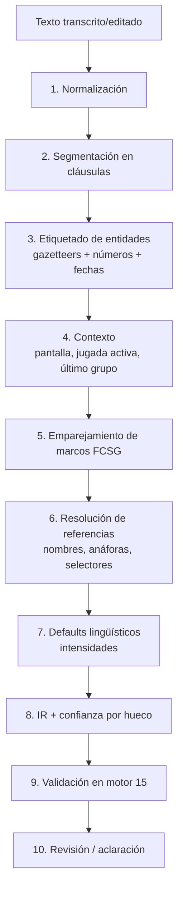

# 16 — Motor de voz y comandos

> Convierte lo que dice el entrenador en **comandos estructurados (IR)** que ejecuta el motor de 15. Ninguna etapa usa IA generativa. La transcripción usa un modelo especializado de reconocimiento del habla, que es la única pieza estadística y está aislada tras un adaptador.

## 1. Capas y presupuesto de latencia

| # | Capa | Componente | Dónde se ejecuta | Latencia objetivo (p95) |
|---|---|---|---|---|
| 1 | Captura | `VoiceRecorder` (MediaRecorder, Opus/WebM o AAC/MP4 en iOS) | Navegador | — |
| 2 | Transcripción | `SttAdapter` → proveedor | Servidor (worker) | ≤ 2,5 s para 30 s de audio |
| 3 | Interpretación | `@fcs/nlu` (gramática FCSG) | Navegador **y** servidor | ≤ 50 ms |
| 4 | Validación | `@fcs/engine` validator | Navegador y servidor | ≤ 20 ms |
| 5 | Ejecución | `@fcs/engine` reducer | Navegador (optimista) + servidor (autoritativo) | ≤ 20 ms |
| 6 | Representación | Renderer SVG | Navegador | 60 fps |
| 7 | Persistencia | API → PostgreSQL | Servidor | ≤ 300 ms |

Total "suelto el botón → veo la propuesta": **≤ 3,5 s** p95 para 30 s de audio.

El texto transcrito es **editable** antes de interpretarse, y el entrenador puede **escribir** en lugar de hablar: la capa 3 no distingue el origen.

## 2. Transcripción (STT)

### 2.1 Opciones

| Opción | Precio (fuente: terceros, a confirmar) | Sesgo de vocabulario | Privacidad | Operación |
|---|---|---|---|---|
| Deepgram Nova‑3 multilingüe | ~0,0043–0,0052 USD/min | **Keyterm prompting** (hasta 100 términos) | DPA; consultar región UE | Gestionado |
| OpenAI gpt‑4o‑mini‑transcribe / whisper‑1 | ~0,003 / 0,006 USD/min | `prompt` de texto (sesgo débil) | DPA; datos en EE. UU. por defecto | Gestionado |
| faster‑whisper (large‑v3‑turbo) autohospedado | Coste de GPU fijo (≈ 250–400 €/mes por instancia) | `initial_prompt` / *hotwords* | Total (UE) | Propio |
| Web Speech API del navegador | Gratis | No | Depende del navegador (audio a terceros) | Inconsistente entre navegadores; descartado |

### 2.2 Decisión (ADR‑006)

- **Adaptador `SttAdapter`** con dos implementaciones desde el día 1: `DeepgramAdapter` (por defecto) y `WhisperSelfHostedAdapter` (planes Club que exijan procesamiento propio en la UE).
- **Sesgo de vocabulario por petición**: nombres, apellidos y apodos de la plantilla activa + nombres de rivales de la jornada + 40 términos futbolísticos de mayor confusión ("primer palo", "rechace", "4‑3‑3", "mediapunta"…), con un máximo de 100.
- Idioma fijado a `es` (evita detección errónea con nombres extranjeros).
- Modo **batch** (grabar y enviar) en el MVP: más simple, más barato y suficiente para órdenes de ≤ 120 s. *Streaming* se reevalúa en V1.5.
- Las alucinaciones de STT en silencios se mitigan con VAD (recorte de silencios inicial/final en cliente) y descartando segmentos con `confidence < 0.4`, que se marcan en la transcripción.

## 3. Interpretación: alternativas evaluadas

| Opción | Tipo | Ventajas | Inconvenientes en este proyecto | Veredicto |
|---|---|---|---|---|
| **Rasa Open Source (NLU)** | Clasificador de intención + extractor de entidades entrenados (DIET) | Ecosistema maduro, Apache 2.0 | Estadístico: resultados cambian con cada reentrenamiento; necesita corpus etiquetado que aún no existe; servicio Python aparte; CALM (con LLM) no es open source | Descartado como dependencia de ejecución; **su formato de datos de entrenamiento se reutiliza** para el corpus |
| **spaCy** (`es_core_news_*` + `EntityRuler`/`Matcher`) | Reglas sobre tokens + modelos estadísticos | Matcher por patrones de tokens muy expresivo; lematización en español | Python en servidor (no en navegador); el lematizador estadístico puede variar entre versiones del modelo | Descartado en ejecución; útil como herramienta de análisis del corpus |
| **Duckling** | Extractor de números/fechas por reglas | Excelente para fechas ("el jueves") | Haskell; servicio aparte | Descartado; se implementa subconjunto en TS (números, fechas relativas, distancias) |
| **Gramáticas PEG/CFG genéricas** (Ohm, Chevrotain, Nearley) | Analizadores sintácticos | Deterministas, TS | El habla no es un lenguaje formal: orden libre, elipsis, muletillas → gramáticas frágiles | Se usan como base técnica (Chevrotain para el *parser* del propio DSL) |
| **Gramática de marcos propia (FCSG) sobre entidades** | Reconocimiento de entidades por diccionario + reglas de marco con huecos de orden flexible | Determinista, explicable, en TS (navegador + servidor), tolerante a orden y relleno | Coste de autoría y mantenimiento de reglas | **Elegido** |

## 4. Pipeline de interpretación (`@fcs/nlu`)



1. **Normalización**: minúsculas; conservar acentos en una copia para mostrar; quitar muletillas (`vale`, `bueno`, `eh`, `a ver`, `pues`, `venga`); separar clíticos de imperativos (`créame → crea`, `pónmelo → pon`); números en letras → dígitos (`cuatro tres tres` → `4 3 3`; `metro y medio` → `1.5 m`); unificar formaciones (`4-3-3`, `4 3 3`, `cuatro, tres, tres` → `F_433`).
2. **Segmentación**: por puntuación de STT y conectores (`y después`, `luego`, `también`, `además`, `por último`, `y quiero`). Cada cláusula se interpreta por separado y comparte contexto.
3. **Etiquetado de entidades** (diccionario, Aho‑Corasick sobre la forma normalizada, preferencia por la coincidencia más larga):

   | Tipo | Ejemplos | Fuente |
   |---|---|---|
   | `PLAYER` | "Lucas", "el 7", "el número cinco", "Pablo Ruiz", apodo "Pitu" | Plantilla activa (dinámico) |
   | `POSITION` / `POSITION_GROUP` | "portería", "centrales", "laterales", "en el medio", "arriba" | `lexicon/es-ES.yaml` |
   | `FORMATION` | `F_433`, "la del Sporting B" (referencia a guardada) | Catálogo + guardadas |
   | `ACTION_TYPE` | "córner ofensivo", "falta lateral", "saque de banda" | lexicón |
   | `SIDE` | "desde la izquierda", "por la derecha", "banda izquierda" | lexicón |
   | `ZONE` | "primer palo", "segundo palo", "frontal", "punto de penalti" | `zones.yaml` |
   | `ROLE` | "rechace", "vigilancia", "bloqueo", "arrastre", "lanzador" | `roles.yaml` |
   | `MOVEMENT` | "atacar", "entrar", "arrastrar a su marca", "venir a recibir" | `movements.yaml` |
   | `DELIVERY` | "cerrado", "abierto", "tenso", "bombeado", "en corto" | lexicón |
   | `QUANTITY` | "dos jugadores", "uno", "otro", "los dos" | gramática numérica |
   | `DISTANCE` / `TIME` / `INTENSITY` | "un metro", "un poco", "antes", "mucho más" | gramática numérica + 14 §11 |
   | `DIRECTION` | "a la izquierda", "hacia delante", "adelanta", "retrasa", "más abierto" | lexicón |
   | `DATE_REF` | "el domingo", "el jueves", "este fin de semana" | gramática de fechas relativa a la jornada activa |
   | `FOOT` | "diestro", "zurdo", "con la derecha" | lexicón |

4. **Contexto**: pantalla activa (`LINEUP_EDITOR`, `PLAY_EDITOR`, `OPPONENT_NOTES`, `TALK_BUILDER`) restringe los marcos candidatos; documento activo; **último grupo mencionado** (para "uno… el otro"); jugador en foco (para "él", "lo").
5. **Marcos FCSG** (sección 5): cada marco tiene huecos tipados obligatorios/opcionales y patrones de superficie. Gana el marco con más huecos obligatorios cubiertos; empate → más tokens consumidos; empate → prioridad declarada. Si dos marcos de **operaciones distintas** empatan → aclaración.
6. **Resolución de referencias** (sección 6).
7. **Defaults lingüísticos**: magnitudes cualitativas (14 §11); dirección implícita ("retrasa" = −u; "adelanta" = +u; "abre" = alejar de `v = 0.5`; "cierra" en defensa = acercar a `v = 0.5`).
8. **IR** con `confidence` por hueco: `EXACT`, `NORMALIZED`, `FUZZY`, `DEFAULTED`, `INFERRED`, `MISSING`.

## 5. Gramática FCSG (Football Coach Studio Grammar)

DSL declarativo, compilado en *build* a matchers TypeScript. Fichero: `docs/engine/grammar/commands.fcsg`.

```text
# Sintaxis
frame <ID> -> <op>             # marco que produce una operación IR
  ctx: <pantallas>              # contextos donde está activo
  slots: nombre:TIPO[!|?|*]     # ! obligatorio, ? opcional, * lista
  pattern: <secuencia>          # literales "…", entidades {nombre}, opcionales [...], alternativas (a|b), comodín ~ (≤ 3 tokens de relleno)
  map: { campo_IR: expresión }  # construcción del IR

# Ejemplo: asignación por línea
frame LINEUP_ASSIGN_GROUP -> lineup.assign_group
  ctx: LINEUP_EDITOR, GLOBAL
  slots: group:POSITION_GROUP!, players:PLAYER*!
  pattern: [en] {group} ~ {players}
         | {players} (de|en|como) {group}
  map: { group: group, players: players, order_hint: "POSITION_FIT" }

# Ejemplo: mover actor
frame PLAY_MOVE_ACTOR -> play.move_actor
  ctx: PLAY_EDITOR
  slots: target:ACTOR_SELECTOR!, distance:DISTANCE?, direction:DIRECTION!
  pattern: (mueve|desplaza|pon|lleva) {target} [{distance}] [hacia] {direction}
         | {target} ~ {distance}? ~ (más) {direction}
  map: { target: target, dx_m: dir_x(direction, distance), dy_m: dir_y(direction, distance) }
```

El orden de los huecos es flexible mediante alternativas y comodines acotados (`~` ≤ 3 tokens), lo que tolera "pon a Lucas, eh, un poco más a la izquierda".

## 6. Resolución de referencias

### 6.1 Jugadores

Orden de búsqueda (determinista):

1. Dorsal explícito ("el 5", "el número cinco", "el cinco" en contexto de jugador) → coincidencia exacta.
2. Nombre completo o nombre + inicial de apellido.
3. Apodo registrado.
4. Nombre de pila único en la plantilla.
5. **Fonético**: clave fonética española (b/v, ll/y, c/z/s ante e/i, h muda, g/j ante e/i, qu/k, acentos) + Jaro‑Winkler ≥ 0,92 → `FUZZY` (requiere confirmación visible, nunca se aplica en silencio).

Si una forma coincide con > 1 jugador (dos "Álvaro") → aclaración con dorsales y fotos. Si un nombre no existe → "No encuentro a *Pedrito* en la plantilla" con los 3 más parecidos y opción "añadir jugador".

### 6.2 Selectores de actores (en jugadas)

| Expresión | Selector IR |
|---|---|
| "Lucas", "el 7" | `{ "player": "pl_7" }` |
| "el lanzador", "el que saca" | `{ "role": "TAKER" }` |
| "los dos del segundo palo" | `{ "zone": "Z_FAR_POST", "expect_count": 2 }` |
| "el jugador del rechace" | `{ "role": "REBOUND", "expect_count": 1 }` → si hay 2: aclaración |
| "los dos de atrás" | `{ "role": "REST_DEFENDER", "expect_count": 2 }` |
| "uno … el otro" | índices 0 y 1 del **último grupo** creado en la locución |
| "él", "lo", "le" | jugador en foco (último singular mencionado); si no hay → aclaración |

`expect_count` se valida: si el selector devuelve un número distinto → aclaración ("Hay 3 jugadores en el segundo palo, ¿a qué dos te refieres?").

### 6.3 Afirmaciones sobre hechos

"Lucas, **que es diestro**" no es una orden: es una **afirmación** (`assert {player, attribute: dominant_foot, value: RIGHT}`). Se compara con la ficha:

- Coincide → se ignora (refuerza confianza).
- No coincide → aclaración `TECH-FOOT-CONFLICT` con opciones: *Actualizar ficha* · *Mantener ficha y usar golpeo de exterior* · *Elegir otro lanzador* · *Cancelar*. La ficha **nunca** se modifica sin elegir la primera opción.

## 7. Gestión de ambigüedades

### 7.1 Taxonomía

| Código | Situación | Ejemplo | Respuesta |
|---|---|---|---|
| `AMB-ENTITY` | Nombre con varias coincidencias | "Álvaro" (hay dos) | Pregunta con opciones |
| `AMB-UNKNOWN-ENTITY` | Nombre inexistente | "Pedrito" | Sugerencias + añadir |
| `AMB-FUZZY` | Coincidencia aproximada | "Matheo" → Mateo | Aplicar marcado en amarillo y pedir confirmación de un toque |
| `AMB-TARGET-MULTI` | Selector devuelve más de lo esperado | "el del rechace" (hay 2) | Pregunta |
| `AMB-OP` | Dos operaciones posibles | "Cambia a Lucas por Mateo" (ambos titulares) | Pregunta: ¿intercambiar posiciones? |
| `AMB-MISSING-REQUIRED` | Falta hueco obligatorio | "Créame un córner" (sin lado) | Pregunta con opciones previsualizadas |
| `AMB-CONFLICT-FACT` | Afirmación contra ficha | "Lucas, que es diestro" (ficha: zurdo) | Pregunta (6.3) |
| `AMB-CONFLICT-RULE` | Orden incompatible con regla técnica | "zurdo desde la izquierda, cerrado" | Aviso + opciones |
| `AMB-OUT-OF-COVERAGE` | Ningún marco aplica | "Que jueguen con más alegría" | "No sé convertir esto en una acción" + guardar como **nota** opcional |
| `AMB-CONTEXT` | Orden de otro módulo | "Cambia a Lucas por Mateo" dentro del editor de jugadas | Aplicar al actor de la jugada o ir a la alineación |

### 7.2 Política de aplicación

```text
si existe hueco MISSING obligatorio      → preguntar (no aplicar)
si existe AMB-* de entidad/operación      → preguntar (no aplicar)
si todo es EXACT/NORMALIZED/DEFAULTED     → aplicar en borrador + mostrar revisión (se puede deshacer)
si hay FUZZY                              → aplicar en borrador resaltado; "Confirmar" obligatorio para guardar
OUT_OF_COVERAGE                           → no aplicar; ofrecer nota o formulación sugerida
```

Preferencia "Revisar siempre antes de aplicar" (activada por defecto las 2 primeras semanas) obliga a confirmar incluso lo inequívoco.

### 7.3 Preguntas

- Máximo **una** pregunta a la vez, con 2–4 opciones tocables y previsualización en el campo; respuesta también por voz ("la primera", "a los dos", "el de la izquierda").
- Las respuestas se convierten en comandos explícitos (`origin = EXPLICIT`).

## 8. Representación intermedia (IR)

Contrato JSON Schema: `docs/engine/command-ir.schema.json`. Envoltorio:

```json
{
  "ir_version": "1.0",
  "utterance_id": "utt_01J…",
  "source": "VOICE",
  "context": { "screen": "PLAY_EDITOR", "doc_id": "play_123", "doc_version": 4, "team_id": "team_1" },
  "reference_frame": "ATTACKING_TEAM",
  "transaction": true,
  "commands": [
    {
      "op": "play.move_actor",
      "target": { "zone": "Z_FAR_POST", "expect_count": 2 },
      "dx_m": 0, "dy_m": -1.0,
      "confidence": { "target": "EXACT", "dy_m": "EXACT", "direction": "EXACT" },
      "span": [0, 61]
    }
  ],
  "clarifications": [],
  "unparsed": []
}
```

`span` vincula cada comando al fragmento de texto que lo originó (resaltado en la revisión). Las operaciones del MVP se enumeran en la sección 10.

## 9. Diccionario de expresiones de entrenador

Fichero completo: `docs/engine/lexicon/es-ES.yaml`. Expresiones pedidas y su interpretación:

| Expresión | Contexto | Interpretación IR | Notas |
|---|---|---|---|
| "Que cierre" | Alineación/defensa, sujeto jugador | `lineup.shift_slot {target, toward: CENTER, dist: 3 m}` (cerrar por dentro) | **Polisémica** |
| "Que cierre" / "que saque cerrado" | Jugada, sujeto lanzador o balón | `play.set_delivery {swing: INSWING}` | Contexto decide; si el sujeto es ambiguo → `AMB-OP` |
| "Que ataque el espacio" | Jugada | `play.set_movement {target, type: RUN_IN_BEHIND, to: zona libre más próxima al destino}` | Si no hay destino → aclaración "¿qué espacio?" con zonas |
| "Que venga a recibir" | Jugada | `play.set_movement {type: CHECK_TO_BALL}` | 6 m hacia el balón |
| "Que arrastre a su marca" | Jugada | `play.set_role {DECOY}` + `play.set_movement {type: DECOY_RUN}` | Destino: alejarse de la zona objetivo |
| "Que haga la pantalla" / "que bloquee" | Jugada | `play.set_role {BLOCKER}` + `play.relation {SCREENS, beneficiary?}` | Sin beneficiario → el `PRIMARY_TARGET` (`INFERRED`) |
| "Que entren desde atrás" | Jugada | `play.set_movement {targets, type: LATE_ARRIVAL}` | Sujeto plural obligatorio |
| "Que el córner vaya cerrado" | Jugada | `play.set_delivery {swing: INSWING}` | Valida TECH‑SWING‑01 |
| "Adelanta un poco los extremos" | Alineación | `lineup.shift_group {group: WINGERS, du_m: +3}` | "un poco" = 3 m |
| "Junta más las líneas" | Alineación | `lineup.compact {axis: U, factor: 0.85}` | 15 % |
| "Abre más a los laterales" | Alineación | `lineup.shift_group {group: FULLBACKS, away_from_center_m: 3}` | |
| "Que el 9 fije a los centrales" | — | **Fuera de cobertura MVP** | Se ofrece guardar como nota |

## 10. Cobertura real del MVP

### 10.1 Operaciones

| Dominio | Operación IR | Ejemplos de superficie | Piloto | V1 |
|---|---|---|---|---|
| Alineación | `lineup.set_formation` | "vamos a jugar 4‑3‑3", "cambia a 4‑4‑2" | ✔ | ✔ |
| | `lineup.assign` | "en portería Pablo", "Mateo de central" | ✔ | ✔ |
| | `lineup.assign_group` | "centrales Mateo y Diego" | ✔ | ✔ |
| | `lineup.substitute` | "cambia a Lucas por Mateo", "entra Hugo por Pedro" | ✔ | ✔ |
| | `lineup.swap` | "intercambia a Lucas y Mateo" | ✔ | ✔ |
| | `lineup.shift_group` | "adelanta un poco los extremos" | ✔ | ✔ |
| | `lineup.shift_slot` | "que el lateral derecho cierre" | — | ✔ |
| | `lineup.compact` | "junta más las líneas" | ✔ | ✔ |
| | `lineup.load` | "utiliza la formación que guardamos contra el Sporting B" | ✔ | ✔ |
| | `lineup.save` | "guarda esta alineación como alternativa ofensiva" | ✔ | ✔ |
| | `lineup.link_match` | "para el domingo" (implícito en create) | ✔ | ✔ |
| | `lineup.clear_slot` | "quita a Pedro" | ✔ | ✔ |
| Jugada | `play.create` | "créame un córner ofensivo desde la izquierda" | ✔ (córner) | ✔ (todos) |
| | `play.set_taker` | "lo saca Lucas" | ✔ | ✔ |
| | `play.set_delivery` | "cerrado", "al primer palo", "tenso" | ✔ | ✔ |
| | `play.adjust_delivery` | "más cerrado", "más pasado" | ✔ | ✔ |
| | `play.add_roles` | "dos jugadores en el segundo palo", "dos esperan el rechace" | ✔ | ✔ |
| | `play.set_role` | "que el 6 sea el bloqueador" | ✔ | ✔ |
| | `play.set_movement` | "haz que el número 5 ataque el primer palo" | ✔ | ✔ |
| | `play.relation` | "uno bloquea al defensor que sigue al otro" | ✔ | ✔ |
| | `play.move_actor` | "mueve a los dos del segundo palo un metro a la izquierda" | ✔ | ✔ |
| | `play.shift_timing` | "el bloqueo tiene que empezar antes" | ✔ | ✔ |
| | `play.constraint` | "los dos de atrás no deben incorporarse al remate" | ✔ | ✔ |
| | `play.assign_player` | "pon a Diego en el bloqueo" | ✔ | ✔ |
| | `play.remove_actor` | "quita al del primer palo" | ✔ | ✔ |
| | `play.add_opponents` | "pon la defensa rival en zona" | — | ✔ |
| | `play.save` / `play.save_variant` | "guárdala como variante B" | ✔ | ✔ |
| Análisis rival | `analysis.extract` (extracción, no comandos) | ver 19 | ✔ | ✔ |
| Charla | `talk.order` / `talk.include` / `talk.note` | ver 20 | — | ✔ |
| Global | `undo`, `redo`, `confirm`, `cancel`, `choose_option` | "deshaz", "vuelve atrás", "sí, la primera" | ✔ | ✔ |
| Navegación | `nav.open` | "abre la jornada 5", "llévame al córner" | — | ✔ |

**Total**: piloto 27 operaciones / V1 ≈ 40. Patrones de superficie: piloto ≈ 180, V1 ≈ 300.

### 10.2 Lo que NO cubre el MVP (y se dice)

Condiciones ("si el rival defiende en zona, entonces…"), comparativas entre jugadas, órdenes sobre fases de juego dinámicas (pressing, salida de balón animada), cadenas de pases de más de 2 golpeos, y cualquier instrucción con valoración subjetiva sin traducción espacial ("más agresivos"). Estas frases se pueden guardar como **notas** ligadas a la jugada o al plan de partido.

### 10.3 Cómo se mide

- **Corpus de evaluación** versionado: 500 locuciones reales de 10 entrenadores piloto (con consentimiento), etiquetadas con el IR esperado (formato YAML derivado del de Rasa NLU).
- Métricas: *exact IR match* (todas las operaciones y huecos correctos), *slot F1*, % de aclaraciones, % fuera de cobertura, y **% de cambios silenciosos incorrectos** (objetivo 0).
- Umbrales de salida del piloto: exact match ≥ 85 % en el corpus *in‑domain*, ≤ 15 % de aclaraciones, 0 cambios silenciosos incorrectos.

### 10.4 Ampliación progresiva

1. Las locuciones con `unparsed` o corregidas manualmente tras aplicarse se registran (si el usuario lo consiente) en una cola de revisión.
2. Semanalmente, el equipo agrupa por similitud léxica (n‑gramas) y decide: nuevo sinónimo (solo lexicón), nuevo patrón (FCSG) o nueva operación (motor + FCSG).
3. Toda ampliación añade casos al corpus; CI bloquea si baja cualquier métrica.
4. Nuevo idioma = nuevo lexicón + gramática (`lexicon/pt-PT.yaml`, `grammar/commands.pt.fcsg`); motor e IR no cambian.

## 11. Interpretación detallada del ejemplo 6.3

Locución: *"Créame un córner ofensivo desde la izquierda. Lo saca Lucas, que es diestro, para ponerla cerrada. Quiero dos jugadores en el segundo palo. Uno bloquea legalmente al defensor que sigue al otro, para liberar su carrera. Otro jugador entra al primer palo, dos esperan el rechace y quiero mantener dos jugadores atrás."*

| # | Cláusula | Marco | IR |
|---|---|---|---|
| 1 | créame un córner ofensivo desde la izquierda | `PLAY_CREATE` | `play.create {type: CORNER_ATT, side: LEFT}` |
| 2 | lo saca Lucas | `PLAY_SET_TAKER` | `play.set_taker {player: pl_7}` |
| 3 | que es diestro | `ASSERT_FOOT` | `assert {player: pl_7, dominant_foot: RIGHT}` → ficha: **LEFT** ⇒ `AMB-CONFLICT-FACT` |
| 4 | para ponerla cerrada | `PLAY_SET_DELIVERY` | `play.set_delivery {swing: INSWING}` |
| 5 | quiero dos jugadores en el segundo palo | `PLAY_ADD_ROLES` | `play.add_roles {count: 2, zone: Z_FAR_POST, group_id: g1}` |
| 6 | uno bloquea legalmente al defensor que sigue al otro, para liberar su carrera | `PLAY_SCREEN_IN_GROUP` | `play.set_role {target: g1[0], role: BLOCKER, strict_legal: true}`, `play.set_role {target: g1[1], role: PRIMARY_TARGET}`, `play.relation {SCREENS, blocker: g1[0], defender: marker_of(g1[1]), beneficiary: g1[1]}` |
| 7 | otro jugador entra al primer palo | `PLAY_ADD_ROLES` | `play.add_roles {count: 1, movement: ATTACK_NEAR_POST, role: SECONDARY_TARGET}` |
| 8 | dos esperan el rechace | `PLAY_ADD_ROLES` | `play.add_roles {count: 2, role: REBOUND}` |
| 9 | quiero mantener dos jugadores atrás | `PLAY_ADD_ROLES` | `play.add_roles {count: 2, role: REST_DEFENDER}` |

No dicho y completado por reglas (marcado como *propuesta*): destino del balón = zona del rematador principal (`Z_FAR_POST`, regla `BALL-TGT-01`), trayectoria `DRIVEN` (`TPL`), 2 jugadores de campo restantes (`SECONDARY_TARGET` al punto de penalti y `DECOY`), jugadores concretos para cada rol (algoritmo de asignación), defensa rival por defecto (mixta). La única pregunta al entrenador es la del pie de Lucas (paso 3). El resultado y las pruebas están en 08 (escenario 2) y en `engine/tests/command-tests.yaml` (T‑CRN‑01..05).

## 12. Extracción para análisis de rivales y charlas

Estos dos módulos **no ejecutan comandos**: clasifican frases. Usan el mismo pipeline hasta el paso 3 y después un clasificador por reglas (patrones + palabras clave ponderadas) que asigna a cada cláusula una categoría y etiquetas, guardando **el texto literal y su posición en la transcripción**. Detalle en 19 y 20.

## 13. Privacidad de la voz

- Audio cifrado en reposo; retención por defecto **30 días** (configurable 0–90); transcripción conservada mientras exista el elemento asociado.
- Sin identificación biométrica del hablante; sin entrenamiento de modelos de terceros con el audio (cláusula contractual con el proveedor; opción *no retention* donde exista).
- El corpus de mejora solo incluye **texto** de usuarios que lo aceptan expresamente, seudonimizado (nombres de jugadores sustituidos por `<PLAYER_n>`).
