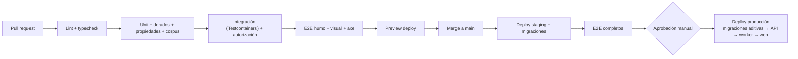

# 27 — Guía de despliegue e infraestructura

> Propuesta para cuando se autorice la construcción. Ningún recurso ha sido creado.

## 1. Topología

| Pieza | Proveedor propuesto | Región | Alternativa |
|---|---|---|---|
| Web (PWA) | Vercel o Cloudflare Pages (estático + SSR ligero) | Edge; sin datos personales persistentes | Netlify |
| API y worker | Contenedores en Fly.io (región `cdg`/`fra`) o Scaleway Serverless Containers (París) | UE | Render (Frankfurt), Railway |
| PostgreSQL, Auth, Storage | Supabase (región UE, p. ej. Frankfurt) | UE | Neon + S3 (UE) + Auth.js |
| STT | Deepgram (verificar región UE y no retención) | — | Whisper autohospedado (Scaleway GPU, UE) |
| Email | Postmark / Brevo (UE) | — | Amazon SES (eu‑west) |
| Errores/métricas | Sentry (región UE) + Grafana Cloud | UE | Self‑hosted |

## 2. Entornos

| Entorno | Uso | Datos |
|---|---|---|
| `local` | Desarrollo con Docker Compose (PostgreSQL 16, MinIO, Supabase CLI) | Sintéticos |
| `preview` | Por PR (web) + API compartida de staging | Sintéticos |
| `staging` | Integración, E2E nocturnos, pruebas del piloto previas | Sintéticos + anonimizados |
| `production` | Usuarios reales | Reales |

## 3. Pipeline CI/CD

- GitHub Actions; imágenes versionadas por SHA; despliegue *rolling* de la API (2+ réplicas).
- Migraciones: `drizzle-kit migrate` en job previo; solo aditivas en caliente (12 §9).
- Compatibilidad de versión del motor: la web y la API publican `engine_version`; durante el despliegue la API acepta N y N‑1 durante 24 h (el cliente desactualizado recibe aviso de recarga).

## 4. Configuración y secretos

| Variable | Dónde |
|---|---|
| `DATABASE_URL`, `SUPABASE_SERVICE_KEY` | Gestor de secretos de la plataforma de la API/worker |
| `SUPABASE_URL`, `SUPABASE_ANON_KEY` | Web (pública por diseño) |
| `STT_PROVIDER`, `DEEPGRAM_API_KEY` | API/worker |
| `AUDIO_RETENTION_DAYS_DEFAULT=30` | API/worker |
| `SENTRY_DSN` | Todos |

Rotación trimestral de claves de servicio; acceso de producción solo con MFA y registrado.

## 5. Copias y recuperación

- PITR del proveedor (7 días) + copia lógica diaria cifrada a un bucket UE distinto (35 días).
- Simulacro trimestral de restauración en staging (RTO objetivo 4 h).
- Storage: versionado activado para exportaciones y escudos; el audio no se versiona (purga).

## 6. Operación

| Tarea | Frecuencia |
|---|---|
| Purga de audio y exportaciones caducadas | Diaria (worker) |
| Revisión de cola de locuciones no entendidas | Semanal |
| Actualización de dependencias (Renovate) | Semanal |
| Informe de costes (infra + STT por activo) | Mensual |
| Revisión de accesos y subencargados | Trimestral |
| Cierre de temporada (anonimizaciones, copia de plantillas) | Anual (julio) |

## 7. Escalado (resumen)

Ver 11 §8. Señales: p95 de `POST /commands` > 300 ms, cola de exportación > 2 min, CPU de BD > 60 % sostenido.
