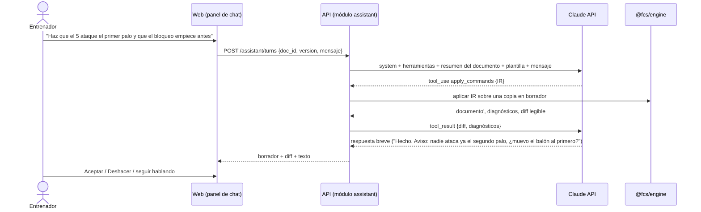

# 31 — Asistente conversacional ("iterar como en un chat")

> Decisión de producto del 26/11/2026: el entrenador debe poder **iterar en lenguaje natural**, como en una conversación con Claude, sobre sus jugadas y escenas de fases de juego. Este documento añade esa capa sin romper el principio central: **el modelo de lenguaje nunca dibuja ni coloca jugadores; solo emite comandos que el motor determinista valida y ejecuta** (ADR‑017).

## 1. Qué cambia respecto al diseño original

| Aspecto | Diseño original (16) | MVP actual |
|---|---|---|
| Entrada | Voz → STT → gramática FCSG | Texto en un chat (la voz sigue aplazada, ADR‑016) |
| Interpretación | Gramática determinista | **Claude (API de Anthropic) con herramientas** cuyo esquema es `command-ir.schema.json` |
| Ejecución | Motor determinista | **Igual**: motor determinista |
| Reproducibilidad | Total (texto → IR → documento) | La **ejecución** es reproducible (IR → documento). La **interpretación** del texto no lo es, así que se guarda el IR de cada turno para poder reproducirlo exactamente |
| Coste variable | STT (~0,15 €/mes por entrenador) | Tokens del modelo (§5) |
| Sin conexión | Texto vía gramática local | Solo edición manual (el chat necesita red) |

El enunciado original pedía no usar un LLM *como requisito para ejecutar jugadas*. Con este diseño sigue sin serlo. Todo se puede hacer con el editor manual y el asistente de formularios, y el chat es una vía más para generar los mismos comandos.

## 2. Arquitectura

- **El servidor guarda la clave**: el navegador nunca habla con la API de Anthropic.
- **Herramientas** (con `strict: true`, esquemas generados desde `command-ir.schema.json`):

  | Herramienta | Qué hace |
  |---|---|
  | `apply_commands` | Aplica un lote de comandos IR al borrador y devuelve el diff y los diagnósticos |
  | `get_document` | Devuelve el documento actual en forma compacta |
  | `get_roster` | Devuelve la plantilla con dorsales, posiciones, pie y estado |
  | `list_catalog` | Devuelve zonas, roles, movimientos y plantillas disponibles |
  | `ask_coach` | Formula una pregunta con 2–4 opciones; la UI la muestra como botones |

- **Contexto**: el *system prompt*, las herramientas y el catálogo son fijos y van en caché. Por turno solo varían el resumen del documento y el mensaje.
- **Límites que el modelo no puede saltarse**: solo existen las operaciones del catálogo; coordenadas, distancias y tiempos los recorta el esquema y los valida el motor; un diagnóstico de tipo `error` impide aplicar.
- **Lo que propone el modelo** se marca con `provenance = ASSISTANT`. Se dibuja como propuesta, con trazo discontinuo, hasta que el entrenador pulsa "Aceptar". Lo que el entrenador pide explícitamente también pasa por el asistente, pero el diff lo muestra antes de aceptar.
- **Ambigüedad**: el *system prompt* obliga a usar `ask_coach` en lugar de suponer, por ejemplo con homónimos, varios candidatos o una orden fuera del catálogo. Se mantiene la regla "nada silencioso": todo cambio aparece en el diff y se puede deshacer.

## 3. Qué puede hacer el entrenador en el chat

- Crear y ajustar jugadas de balón parado ("Córner desde la derecha, saca Lucas cerrado, tres al segundo palo…").
- Crear y ajustar **escenas de fases de juego** (32): "Enséñame cómo presionamos cuando su central conduce hacia su lateral izquierdo", "Bloque bajo contra su 4‑3‑3", "Deja tres en vigilancia con su 9 y su 11 arriba".
- Preguntar por qué ("¿Por qué el 4 está ahí?"). El asistente responde citando la regla y la `provenance`, que recibe del motor.
- Hacer cambios en lote ("Pasa esta presión al 4‑4‑2").

No puede inventar jugadores, modificar fichas sin confirmación (`ask_coach` + acción explícita) ni compartir nada. Publicar y compartir siguen siendo acciones manuales.

## 4. Privacidad

- MVP solo con equipos sénior: los datos enviados son nombres, dorsales, posiciones y pie de adultos. No se envían notas privadas ni estado médico; las lesiones se envían solo como "no disponible".
- Anthropic actúa como subencargado de tratamiento y se añade a la lista pública de 21 §6. Hay que revisar las condiciones de retención de datos del plan de API contratado.
- Los turnos (mensaje, IR y respuesta) se guardan 90 días para soporte y mejora. El entrenador puede borrarlos.

## 5. Coste por modelo (estimación)

Supuestos por turno: ~10.000 tokens de contexto en caché (*system prompt*, herramientas, catálogo, plantilla), ~1.000 tokens de entrada nuevos (mensaje y resumen del documento) y ~1.500 de salida (comandos, respuesta y razonamiento). Precios de lista de la API de Anthropic (noviembre de 2026, USD por millón de tokens).

| Modelo | Precio entrada / salida / lectura de caché | Coste por turno | 100 cuentas × 300 turnos/mes | Por cuenta y mes |
|---|---|---|---|---|
| Claude Opus 5.5 (`claude-opus-5-5`) | 4 / 20 / 0,20 | ~0,036 $ | ~1.080 $ | ~10,8 $ |
| Claude Sonnet 5.5 (`claude-sonnet-5-5`) | 2 / 10 / 0,10 | ~0,018 $ | ~540 $ | ~5,4 $ |
| Claude Haiku 5.5 (`claude-haiku-5-5`) | 0,10 / 0,50 / — | ~0,001 $ | ~30 $ | ~0,3 $ |

- Con 100 turnos al mes por cuenta, los costes se dividen entre tres.
- Las escenas de fases completas (32) generan más salida: unas 2–3 veces el coste de un turno.
- Hay que medirlo con conversaciones reales del piloto antes de fijar el precio. Las palancas son: caché, nivel de esfuerzo bajo o medio en órdenes simples y **cuotas por plan**.

Implicación para el plan de 100 cuentas: con el asistente incluido, 7,99 €/mes **no cubre** Opus ni Sonnet con uso intensivo. Opciones:

1. Precio de 15–25 €/mes con una cuota de turnos.
2. Plan básico sin asistente y plan "Asistente" de pago.
3. Un modelo más barato para las órdenes simples.

Elegir el modelo es una decisión de producto pendiente (23 §0).

## 6. Pruebas

- Los 39 casos de `engine/tests/command-tests.yaml` se reutilizan como **evaluación del asistente**: frase → ¿el IR generado coincide con el esperado (o con uno equivalente) y produce el mismo documento?
- Métricas: % de turnos que se resuelven sin corrección, % de preguntas pertinentes y **0 cambios aplicados fuera del diff mostrado** (garantizado por la arquitectura).
- Ejecutar la evaluación tiene coste, así que se lanza con presupuesto acordado y en cada cambio de *prompt* o de modelo.

## Anfitriones (Pizarra Studio, 27/11/2026)

El bucle (`runTurn`), el prompt, la validación IR y los espacios de trabajo viven en `packages/assistant` y se usan igual en los dos anfitriones (ADR‑021):

| | Página de Claude | Servidor propio |
|---|---|---|
| Modelo | `sample` de la página (cuenta de quien la usa), con herramientas; plan B `sample.json` | `LlmAdapter` (Anthropic por defecto, `ASSISTANT_MODEL`) |
| Dónde se ejecuta el motor | En el navegador (`execute` de cada herramienta) | En el servidor (`POST /api/teams/:id/studio/assistant`) |
| Qué se devuelve | Los cambios llegan por el espacio de trabajo | `{reply, clarification, state}` |
| Deshacer | Un turno = una entrada del historial del editor | Igual (el editor es el mismo) |

Espacios de trabajo: `boardWorkspace` (órdenes `board.*`), `setPieceWorkspace` (`create_setpiece` y edición `play.*`, incluido `play.mark`) y `sceneWorkspace` (`update_scene`). Los resultados de las herramientas ocupan ≤ 1 KB y el contexto ≤ 4 KB.
